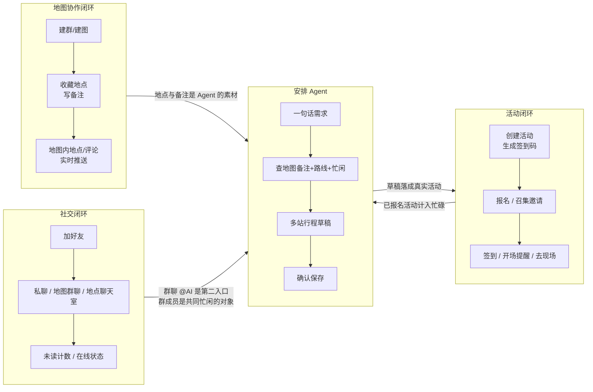
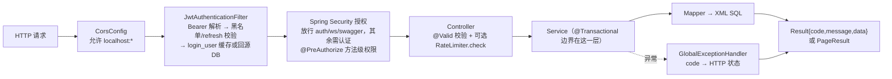
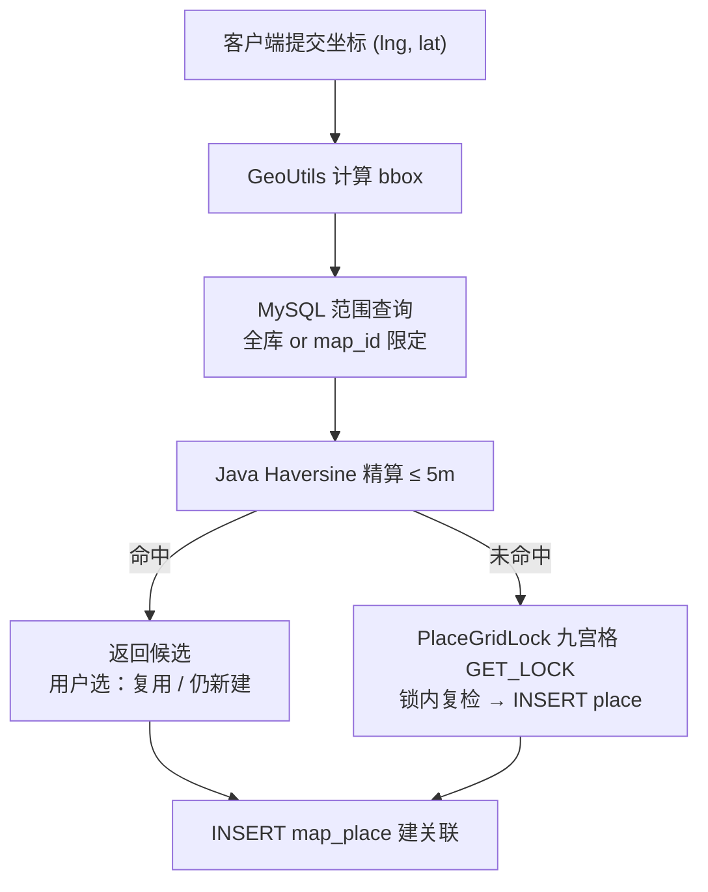
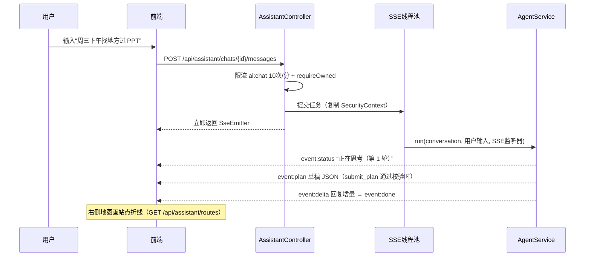
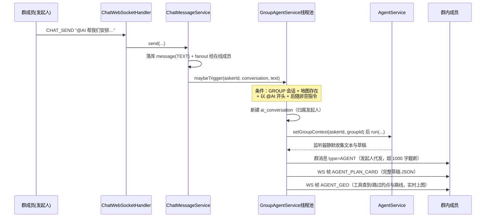
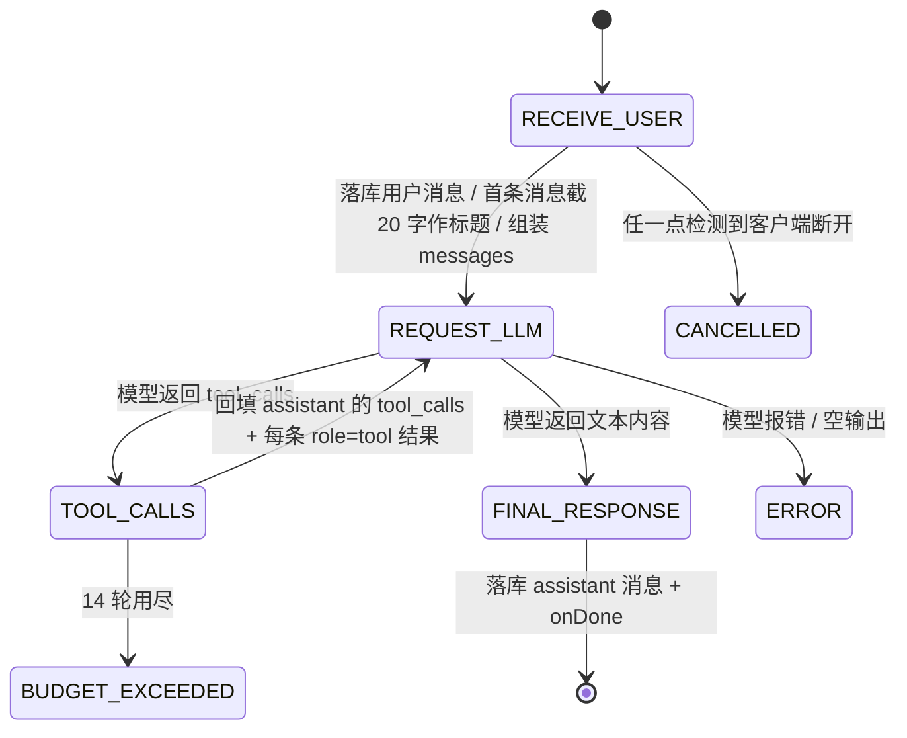
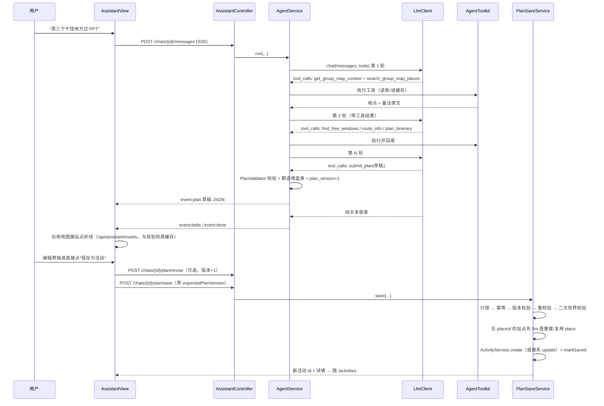
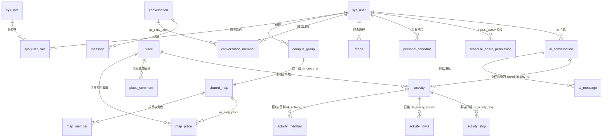
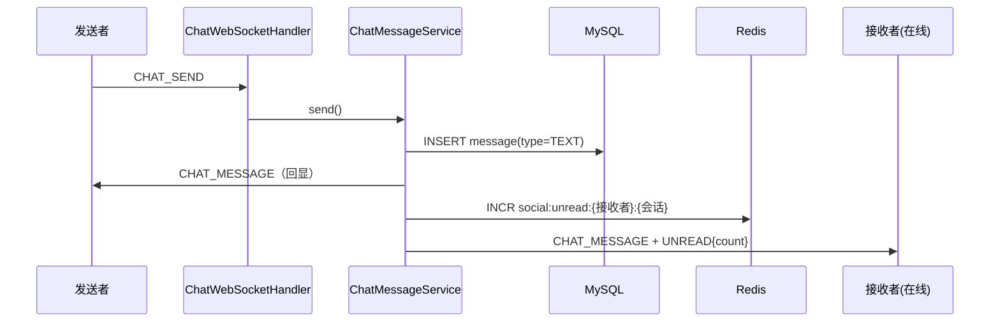

# 操作逻辑与业务流程说明

> **历史快照（2026-10-17 版，2026-10-22 标注）**：本文保留 Agent 深度细节，但数字/导航以 [`项目全流程说明.md`](./项目全流程说明.md) 为准。当前口径：**33 张表、8 个迁移、13 个 Agent 工具（12 可执行 + submit_plan）、185 个后端测试、46 个前端测试**；顶栏为「地图/消息/日程/AI 助手」，执行追踪在账号菜单「开发者视图」。体验问题见 [`体验与流程问题清单.md`](./体验与流程问题清单.md)。

> 目的：把「这个项目到底是怎么运转的」讲清楚。先讲整体运行视图与各业务模块的操作逻辑，再用最重的篇幅讲清**安排 Agent**（AI 活动规划助手 / 时空协同智能体）的操作、业务与数据流。
>
> 口径：**以代码为准**。本文所有数字、常量、帧名、key 名都取自当前 `main` 分支的源码（提交 `18a3b26`），并标注了出处文件。`docs/` 下既有文档（开发计划、工作报告）里的部分数字已过时，凡有冲突以本文与代码为准，主要差异见[第 6 章](#第-6-章-最容易搞错的-20-条)。

---

## 目录

- [第 0 章 阅读说明](#第-0-章-阅读说明)
- [第 1 章 一分钟看懂项目](#第-1-章-一分钟看懂项目)
- [第 2 章 系统怎么跑起来](#第-2-章-系统怎么跑起来)
- [第 3 章 业务模块操作逻辑](#第-3-章-业务模块操作逻辑)
- [第 4 章 安排 Agent：操作逻辑全景](#第-4-章-安排-agent操作逻辑全景)
- [第 5 章 数据流程](#第-5-章-数据流程)
- [第 6 章 最容易搞错的 20 条](#第-6-章-最容易搞错的-20-条)
- [第 7 章 已知限制与二期项](#第-7-章-已知限制与二期项)
- [第 8 章 附录](#第-8-章-附录)

---

## 第 0 章 阅读说明

### 「安排 Agent」指什么

本文所说的「安排 Agent」，指项目里的**活动规划智能体**：用户用一句自然语言描述想做的事（"周三下午找三个人在能讨论的地方过一下 PPT"），Agent 去查共建地图里的地点与备注、查真实路线耗时、查相关人的忙闲，输出一份**结构化多站行程草稿**，用户确认后落成系统里真实的活动（之后报名、签到、提醒照常走）。

它在代码里的位置：

| 关注点 | 代码位置 |
|--------|----------|
| 主循环（状态机） | `campus-server/src/main/java/com/campus/ai/service/AgentService.java` |
| 工具集（12 个可执行工具） | `.../ai/tool/AgentToolkit.java` |
| 个人入口（SSE 流式） | `.../ai/controller/AssistantController.java` |
| 群聊入口（@AI） | `.../ai/service/GroupAgentService.java` |
| 草稿校验 | `.../ai/plan/PlanValidator.java` |
| 时空调度求解 | `.../ai/planner/SpatiotemporalPlanner.java`、`FreeWindowSolver.java` |
| 草稿确认保存 | `.../ai/service/PlanSaveService.java` |
| 共建地图上下文与指纹 | `.../ai/service/GroupMapContextService.java` |
| LLM 客户端 | `.../ai/llm/LlmClient.java` |
| 高德适配器 | `.../ai/travel/AmapTravelProvider.java` |
| 前端页面 | `campus-web/src/views/AssistantView.vue`（个人）、`campus-web/src/components/ChatPanel.vue`（群聊卡片） |

### 阅读路径建议

- **只想知道项目怎么转** → 第 1、2 章，然后按需看第 3 章对应模块。
- **只想搞懂 Agent** → 第 4 章全章 + [5.4](#54-redis-数据流key-全表)/[5.5](#55-websocket-数据流) 两节 + 第 6 章里带 ★ 的条目。
- **要改代码** → 第 5 章的数据模型与第 8 章的文件索引，改表时务必看 [8.4 维护提示](#84-维护提示)。
- **要讲给别人听** → [1.2 四大闭环](#12-四大闭环它们怎么互相供血)、[4.6 端到端时序](#46-端到端时序从一句话到活动)、[4.7 四处防线](#47-草稿生命周期的四处防线别混为一谈)。

---

## 第 1 章 一分钟看懂项目

### 1.1 三句话定位

1. **它是一个校园协作应用**：几个同学建一张**共建地图**，往地图里收藏地点、在下面留备注（"这里安静适合讨论"），并在地点上**发起活动**——报名、召集、签到、开场提醒、活动结束后"去现场"看地图，形成完整闭环。
2. **它到处是实时的**：地图加地点、好友申请、聊天消息、活动被召集/取消/临近开场，都会通过一条 WebSocket 长连接推给相关的在线用户，不需要刷新页面。
3. **它上面叠了一个「安排 Agent」**：把"一句话的需求"变成"一个真实活动"。Agent 感知的是**你和你所在群组共同积累的地点与备注**，用的是**高德的真实路线耗时**，判可行性靠的是**后端确定性算法**（不是模型拍脑袋）。

### 1.2 四大闭环，它们怎么互相供血



一句话概括供血关系：**地图和社交喂给 Agent 素材，Agent 的产出落进活动闭环，活动闭环的时间占用又回流成 Agent 做规划时的约束（忙闲）**。

### 1.3 谁会用到什么

> 登录后的所有页面共用一个**全局顶栏导航壳**（`campus-web/src/components/AppShell.vue`）：品牌可点回首页，固定导航「我的地图 / 好友（好友申请角标）/ 活动日程 / AI 助手」+ 退出；WebSocket 连接也由壳统一建立。各页面自身的顶栏已删除；工作台首次进入有可关闭的三步引导卡。

| 角色 | 能做什么 | 入口页面 |
|------|----------|----------|
| 未登录游客 | 注册 / 登录 | `/login` |
| 登录用户 | 建群建图、邀请码入群、加好友、私聊、看活动 | `/`（地图列表）、`/friends`、`/activities` |
| 地图成员 | 收藏/编辑地点、写备注、地图群聊、发起活动 | `/maps/:id`（工作台，最重的页面） |
| 活动创建者 | 编辑/取消、召集邀请、看签到码、看成员签到情况 | `/maps/:id`、`/activities` |
| 被邀/报名用户 | 接受/拒绝邀请、报名、输码签到 | `/activities` |
| 规划者（任何人） | 与 Agent 对话、编辑草稿、保存成活动 | `/assistant` |
| 群成员（任何人） | 在群聊里 `@AI 帮我规划…`，收到规划卡片 | `/maps/:id` 的群聊面板 |
| 管理员 | 用户封禁、地点/动态隐藏、举报处理 | 仅后端接口，**前端未接入** |

### 1.4 技术栈与目录

| 层 | 技术 | 说明 |
|----|------|------|
| 后端 | Java 17 + Spring Boot 3.5 + Spring Security 6 + MyBatis（XML，无 MyBatis-Plus） | Maven 多模块 |
| 存储 | MySQL 8（权威数据）、Redis 7（登录态/缓存/限流/未读/在线态） | 33 张表（历史章节仍写 29 张，以项目全流程说明为准） |
| 实时 | 原生 WebSocket（`/ws`）+ SSE（AI 个人对话流式） | 帧清单见 [5.5](#55-websocket-数据流) |
| 前端 | Vue 3 + Vite + Element Plus + 高德 JS API | `campus-web/src/{views,components,composables,api}` |
| AI | DashScope OpenAI 兼容模式（`qwen-plus`）+ Function Calling | 流式；后端零新增 Maven 依赖（JDK HttpClient + SseEmitter），前端新增 `marked`+`dompurify` 用于 AI 回复的 Markdown 渲染 |
| 地理 | 高德 Web 服务 API（路线 v5 / POI v3） | 仅一个适配类 `AmapTravelProvider` |

```text
campus/                          # 聚合父 POM
├── campus-framework/            # 脚手架基础设施（jar，无启动类）
│   └── com.campus: common(Result/异常/限流/RedisKey) / config / security(JWT/RBAC) / auth / user
├── campus-server/               # 校园业务 + 启动类（可执行 jar）
│   └── com.campus: profile / place / post / map / social / activity / schedule / report / search
│                 / admin / ws / ai(agent) / common.{geo,util}
├── campus-web/                  # Vue 3 前端（5173，代理 /api 与 /ws 到 8080）
├── docs/                        # 需求、计划、报告与本文件
└── tools/                       # 演示与性能脚本（Node）
```

依赖方向**严格单向**：`campus-server → campus-framework`，框架模块不引用任何业务类型（这是 `d8e7d11` 那次拆分的核心目的）。前端 `campus-web/src/api/index.js` 里定义的全部接口、以及后端存在但前端没接的接口，见 [7.1](#71-后端有但前端没接的接口)。

---

## 第 2 章 系统怎么跑起来

### 2.1 进程与端口

| 进程 | 地址 | 配置位置 |
|------|------|----------|
| 后端（campus-server） | `localhost:8080` | `campus-server/src/main/resources/application-dev.yml` |
| 前端 dev server | `localhost:5173`，代理 `/api`、`/ws` → 8080 | `campus-web/vite.config.js` |
| MySQL 8 | `localhost:3306`，库 `campus`，账号 `campus/campus123` | `docker-compose.yml` |
| Redis 7 | `localhost:6379`（db0，无密码） | 同上 |

```bash
# 1. 依赖（MySQL 首次启动会执行挂载进去的 schema.sql + data.sql）
docker compose up -d

# 2. 后端（根目录是聚合 POM，可执行模块是 campus-server）
mvn -pl campus-server -am spring-boot:run

# 3. 前端
cd campus-web && cp .env.example .env    # 填 VITE_AMAP_KEY（前端 JS key）
npm install && npm run dev

# 4. 接口文档
#    http://localhost:8080/swagger-ui.html（分组：脚手架基础设施 / 校园业务）
```

**存量库迁移**（`docker-compose` 的 initdb 只对新数据卷生效，旧库要手工执行）：

```bash
docker compose exec -T mysql mysql -ucampus -pcampus123 campus < campus-server/src/main/resources/db/migration/20261015_01__create_activity_stop.sql
docker compose exec -T mysql mysql -ucampus -pcampus123 campus < campus-server/src/main/resources/db/migration/20261015_02__create_ai_tables.sql
docker compose exec -T mysql mysql -ucampus -pcampus123 campus < campus-server/src/main/resources/db/migration/20261016_01__create_personal_schedule.sql
```

**配置来源与优先级**：`application.yml`（激活 dev、导入 secrets）→ `application-dev.yml` → `application-secrets.properties`（git 忽略，放 `DASHSCOPE_API_KEY` / `AMAP_WEB_KEY`）→ 同名环境变量可覆盖。

关键配置项：`campus.jwt.access-token-expiration=1800`（秒）、`refresh-token-expiration=604800`、`campus.llm.base-url=https://dashscope.aliyuncs.com/compatible-mode/v1`、`campus.llm.model=qwen-plus`、`campus.llm.max-tokens=2048`、`campus.amap.web-key`（注意：这是**高德「Web 服务」key**，与前端 `.env` 里的 JS API key 是两把不同的 key）。

**测试**：`mvn test`（或 `mvn -pl campus-server -am test`）。测试全部在 campus-server，绝大多数用 Testcontainers 起真实 MySQL + Redis，**需要本机 Docker**。当前基线 **185 例全绿**（第三轮 168 + 第四轮新增 17；前端 46/46）。其中 mock 掉大模型的用例（`AgentChatMockedAcceptanceTest`）不需要真实 API key 就能跑通全链路。

### 2.2 一次 HTTP 请求的横切顺序

后端没有 Spring MVC 的 `HandlerInterceptor`，也没有 AOP 切面。所有横切能力集中在安全过滤链 + 全局异常处理 + 显式调用上：



要点：

- **鉴权分两种**：REST 用 `Authorization: Bearer <accessToken>`；WebSocket 用握手 URL 上的 `?token=`（见 [5.5](#55-websocket-数据流)）。两者都拒绝 refresh 型 token 与已登出（黑名单）的 token。
- **身份获取**：业务代码统一用 `SecurityUtils.getUserId()` / `getLoginUser()` 读 `SecurityContext`，不自己解析 token。
- **返回值**：一律 `Result<T>`；`PageResult{list,page,size,total}` 用于分页。异常一律由 `GlobalExceptionHandler` 转成对应 HTTP 状态码 + 同样结构的 body。
- **限流**：`RateLimiter.check(bizKey, 次数, 窗口)`，Redis Lua（INCR + PEXPIRE）固定窗口，超限抛 `RateLimitException` → 429。当前全部调用点只用 7 处，见下表。

### 2.3 横切能力清单

**限流点（全部调用点）**

| bizKey | 阈值 | 位置 |
|--------|------|------|
| `auth:login:{ip}` | 10 次/分 | `campus-framework/.../auth/service/AuthService.java` |
| `post:create:{userId}` | 10 次/分 | `campus-server/.../post/controller/PostController.java` |
| `place:create:{userId}` | 5 次/分 | `campus-server/.../place/controller/PlaceController.java` |
| `activity:create:{userId}` | 10 次/分 | `campus-server/.../activity/controller/ActivityController.java` |
| `activity:join:{userId}` | 15 次/分 | 同上 |
| `activity:checkin:{userId}` | 10 次/分 | 同上 |
| `ai:chat:{userId}` | 10 次/分 | `campus-server/.../ai/controller/AssistantController.java`（**只限流 AI 发消息**，保存/修订/路线预览不限流） |

**异常 → HTTP 映射**（`campus-framework/.../common/exception/GlobalExceptionHandler.java`）

| 业务 code | HTTP | 典型场景 |
|-----------|------|----------|
| 400 | 400 | 参数校验失败、业务前置条件不满足（满员、窗口外、草稿非法） |
| 401 | 401 | 未登录 / token 失效 |
| 403 | 403 | 非地图成员、未报名签到、权限不足 |
| 404 | 404 | 会话/活动/地点不存在（**跨用户访问也返回 404，不泄露存在性**） |
| 409 | 409 | 草稿版本竞赛、共建地图/忙闲在规划期间变化（见 [4.7](#47-草稿生命周期的四处防线别混为一谈)） |
| 429 | 429 | 限流、地点写入繁忙（格网锁超时） |
| 500 | 500 | 未预期异常、高德 key/配额异常 |

**"逻辑删除"约定**：没有 `deleted_at` 软删，全部用 `status` 标记 + 查询过滤，语义逐表不同：

| 表 | status 语义 | 备注 |
|----|-------------|------|
| `sys_user` | 1 正常 / 0 禁用 | 禁用后登录被拒，好友搜索过滤 |
| `place` | 1 正常 / 0 隐藏 | 读路径 404，但 `map_place` 关联行保留 |
| `post` | 1 正常 / 0 隐藏 | 列表/点赞/评论都要求 1 |
| `activity` | 1 有效 / 0 已取消 | "报名中/进行中/已结束"是**响应里的 phase 字段，库里没有**（读时计算） |
| 好友、会话、评论、日程 | —— | **物理删除**；取消报名也是物理删 `activity_member` 行 |

**分页**：没有 PageHelper。`PageUtils.normalizePage/normalizeSize`（默认 20、上限 50）+ SQL 里显式 `LIMIT/OFFSET` + 单独 `COUNT`。部分接口是定长查询（如活动"我的日程"上限 200 条、聊天消息游标分页 `beforeId` + `limit≤100`）。

**事务**：`@Transactional` 全部落在 Service 层（约 40 处）。注意 `PlaceServiceImpl.createPlace` 显式用 `READ_COMMITTED`，原因见 [3.2](#32-共享地图与共建地点)。

---

## 第 3 章 业务模块操作逻辑

本章每个模块按同一模板写：**谁能做什么 → 调用链 → 数据落在哪 → 谁被实时通知**。

### 3.1 认证与账号

**操作逻辑**

| 操作 | 接口 | 规则 |
|------|------|------|
| 注册 | `POST /api/auth/register` | 默认角色 USER，密码 BCrypt |
| 登录 | `POST /api/auth/login` | IP 限流 10 次/分；签发 **access（30 分钟）+ refresh（7 天）** |
| 刷新 | `POST /api/auth/refresh` | **Rotation**：先删旧 refresh，再发新的一对 |
| 登出 | `POST /api/auth/logout` | access token 进黑名单（TTL = 剩余有效期），清 `login_user` 缓存 |
| 改资料 | `GET/PUT /api/users/me` | 头像目前只是**URL 字符串**，无上传（见 [7.2](#72-已知限制完整清单)） |

**调用链与数据位置**

```text
LoginView → POST /api/auth/login
  → AuthService.login（限流 → BCrypt 校验 → 状态检查）
  → JwtTokenProvider 签发：claims = userId / username / tokenId / type
  → Redis: refresh_token:{tokenId} = userId（TTL 7 天）
  → Redis: login_user:{userId} = LoginUser JSON（含角色与权限，TTL 30 分钟）
  → 返回 accessToken + refreshToken → 前端存 localStorage
```

**每次请求的鉴权**：`JwtAuthenticationFilter` 解析 Bearer → 检查 `blacklist:{tokenId}` 与 type → 读 `login_user:{userId}` 缓存，未命中就回源 DB（`UserService.loadLoginUser`）并回写。这里有个**已知的不一致**：登录/刷新写 30 分钟，过滤器回源补写 1 小时，所以角色变更最长 1 小时才生效（封禁用户会主动清缓存，是例外）。

**前端现状**：token 存 `localStorage`，axios 请求拦截器自动加 `Authorization` 头，响应 401 就清 token 整页跳登录。**前端没有实现自动刷新**——`/api/auth/refresh` 接口与 refreshToken 存储存在，但没有任何调用点。access 过期（30 分钟）即需要重新登录。

**实时通知**：无（登录不推送）。

---

### 3.2 共享地图与共建地点

这是整个产品的数据地基，也是 Agent 的素材来源。

**三层结构**：`campus_group`（群，1:1）→ `shared_map`（共享地图）→ `map_member`（成员+角色）与 `map_place`（地图↔地点的多对多）。

- 角色 `MapRole`：`OWNER(3) > EDITOR(2) > VIEWER(1)`；可见性 `MapVisibility`：`MEMBERS`（默认）/`PUBLIC`。
- 群用 8 位**邀请码**入群（`campus_group.uk_invite_code`），入群默认 EDITOR；只有 OWNER 能改成员角色、移除成员、看到邀请码。
- **同一地点可以出现在多张地图**（`map_place` 多对多，不重复存坐标）；**备注是地图维度的**：`place_comment` 挂在 `(map_id, place_id)` 上，同一个地点在不同地图下的备注互不相通——这条对理解 Agent 的"群内备注"很关键。

**操作逻辑（关键接口）**

| 操作 | 接口 | 权限 |
|------|------|------|
| 建群+建图 | `POST /api/groups` | 登录即可；返回 mapId 与邀请码 |
| 邀请码入群 | `POST /api/groups/join` | 登录即可 |
| 我加入的地图 | `GET /api/maps` | 登录即可 |
| 地图详情/成员 | `GET /api/maps/{id}` | MEMBERS 可见性下非成员 403 |
| 改角色/移除成员 | `PUT/DELETE /api/maps/{id}/members/{userId}` | 仅 OWNER |
| 地图内加地点 | `POST /api/maps/{id}/places` | EDITOR+，**5m 融合（仅本图范围）** |
| 分享已有地点到地图 | `POST /api/maps/{id}/places/{placeId}` | EDITOR+，同样 5m 校验 |
| 解除地点关联 | `DELETE /api/maps/{id}/places/{placeId}` | EDITOR+；只删关联不删地点 |
| 地点备注/评论 | `GET/POST /api/maps/{id}/places/{placeId}/comments` | 地图成员 |
| 全局建地点 | `POST /api/places` | `place:create` 权限 + 5 次/分，**5m 融合（全库范围）** |
| 附近/视野查询 | `GET /api/places/nearby`、`GET /api/places/map` | 半径默认 500m 上限 5000m；视野查询最多返回 200 条 |
| 地点详情 | `GET /api/places/{id}` | Redis 缓存 10 分钟 |
| 该地点在哪些图 | `GET /api/places/{id}/maps` | "去现场"用（见 3.4） |

**两条 5m 融合路径语义完全不同**（README 也强调过，最容易记混）：

| | 全局路径 `POST /api/places` | 地图内路径 `POST /api/maps/{id}/places` |
|---|---|---|
| 查重范围 | **全库** `place` 表 | **仅该地图已关联的地点** |
| 命中后 | 返回 `candidates`，`confirmNew=true` 可强制新建 | 返回 `duplicatePending` + `candidates`，可选"补充已有地点"（只 `INSERT map_place`）或"仍新建" |
| 产品定位 | 兼容验收保留 | 产品主路径 |

推论：**地图 A 里的 5m 候选不会阻止你在南图 B 的同坐标新建或关联**。

**并发防线（为什么要有格网锁）**：`place` 表对坐标**没有唯一键**，"先查后插"两步之间存在并发窗口——实测在 `REPEATABLE READ` 下 10 个并发同坐标请求会产生多条重复地点。解法是 `PlaceGridLock`：以 0.0001°（约 10~11m，大于 5m 融合半径）为格取**九宫格** `GET_LOCK` 命名锁，按字典序逐个加锁（超时 5 秒 → 429"地点写入繁忙"），锁内先复检再插入；`createPlace` 用 `READ_COMMITTED`（否则锁内复检看不到刚提交的行）；锁在事务完成后释放。高德 POI 转系统地点（Agent 保存草稿时）走同一个入口，自动享受这套保护。



**数据落在哪**：`place`（坐标权威，GCJ-02）/ `map_place`（关联）/ `place_comment`（地图维度备注）；Redis 只在 `place:detail:{placeId}` 缓存详情 10 分钟（发帖、点赞、评论、编辑地点都会主动失效）。

**实时通知**：`MapEventNotifier` 在**加地点/分享地点/解除关联/地点评论/修改地点信息**时，向该地图的在线成员推 `PLACE_CHANGED` 帧（操作者自己除外），前端收到后重新拉取。

---

### 3.3 好友与聊天

**好友**

| 操作 | 接口 | 说明 |
|------|------|------|
| 好友列表 | `GET /api/friends` | 带在线状态 |
| 搜索用户 | `GET /api/friends/search?keyword=` | 过滤被禁用用户 |
| 申请/收到的申请 | `POST /api/friends/requests`、`GET /api/friends/requests` | 发送时直接推 WS |
| 接受/拒绝 | `POST /api/friends/requests/{id}/accept`、`.../reject` | 接受时双向写 `friend` 两行 |
| 删除好友 | `DELETE /api/friends/{userId}` | 一次删两行 |

**会话有三种类型，成员权威来源各不相同**（这是聊天模块最容易搞错的地方）：

| 类型 | 什么场景 | 成员/接收人从哪里来 | 访问校验 |
|------|----------|--------------------|----------|
| `PRIVATE` | 好友私聊 | `conversation_member`（恰两人） | **每次访问实时校验是否仍是好友**，删好友后历史会话立即 403（消息不删） |
| `GROUP` | 地图群聊 | **`map_member`**（`conversation_member` 只是"会话列表里能看到"的记录，幂等同步） | 必须是地图成员 |
| `PLACE` | 地点聊天室 | 任何登录用户打开即加入 | 登录即可 |

**消息发送链路（WebSocket 上行 `CHAT_SEND`）**：

```text
ChatPanel → ws.send({type:'CHAT_SEND', conversationId, content})
  → ChatWebSocketHandler.handleTextMessage
  → ChatMessageService.send
      1) requireConversation + assertCanAccess（按上表三种规则）
      2) 校验 content 非空且 ≤1000 字
      3) INSERT message（type=TEXT）
      4) fanout：
         - 发送者本人：回推 CHAT_MESSAGE（前端不做本地乐观插入，回显以服务端广播为准）
         - 其他人：Redis INCR social:unread:{uid}:{convId}；在线者再推 CHAT_MESSAGE + UNREAD{count}
      5) 若 GROUP 且文本以 "@AI" 开头 → GroupAgentService.maybeTrigger（异步，见第 4 章）
```

**上行帧只有 4 种**：`CHAT_SEND` / `TYPING` / `READ` / `PING`（`PING` 回 `PONG`）。**下行帧见 [5.5 全表](#55-websocket-数据流)**。

**未读与在线**：未读数是 Redis 计数器，**没有 TTL**，打开会话/拉历史消息即清零；在线态以 `WsSessionRegistry` 的**进程内 Map** 为权威（Redis 的 `social:online` 集合是给多实例演进预留的记录，且没有 TTL，进程崩溃会残留）。首连/末断会给好友广播 `PRESENCE`。

**前端连接方式**（`campus-web/src/composables/useChatSocket.js`）：登录后任意页面 `connect()`，URL 为 `ws(s)://{host}/ws?token=<accessToken>`；30 秒发一次应用层 `PING` 防代理断连；断线后指数退避重连（1s 起，×2，封顶 15s）；页面通过 `on(type, cb)` 订阅下行帧。

**离线语义**：**没有离线消息推送，也没有离线通知表**。消息本身已落 MySQL，未读数在 Redis；用户重连后靠 REST 拉历史（`GET /api/conversations/{id}/messages?beforeId&limit`）补齐。这是二期的抓手（[7.2](#72-已知限制完整清单)）。

---

### 3.4 活动：从创建到"去现场"

**操作逻辑全表**

| 步骤 | 接口 | 规则（常量都在 `ActivityServiceImpl`） |
|------|------|----------------------------------------|
| 创建活动 | `POST /api/activities` | 10 次/分；生成 **6 位签到码**；创建者自动入成员；可选带 `stops` 多站行程 |
| 编辑 | `PUT /api/activities/{id}` | **仅创建者、未开始**；改开始时间会顺延签到窗口 |
| 取消 | `DELETE /api/activities/{id}` | 仅创建者；推 `ACTIVITY_CANCELLED` |
| 我的日程 | `GET /api/activities/mine?role=created / joined / all` | 带 phase 与 stops |
| 报名 / 取消 | `POST/DELETE /api/activities/{id}/join` | 15 次/分；满员 400；重复报名靠唯一键幂等 |
| 成员与签到情况 | `GET /api/activities/{id}/members` | 仅成员可见 |
| 输码签到 | `POST /api/activities/{id}/checkin` | 10 次/分；**窗口 = 开始前 15 分钟 ~ 开始后 15 分钟**；须先报名 |
| 召集邀请 | `POST /api/activities/{id}/invites` | 仅创建者；被邀人收到 `ACTIVITY_INVITED` |
| 待响应邀请 | `GET /api/activity-invites/pending` | 我收到的 |
| 接受 / 拒绝 | `POST /api/activity-invites/{id}/accept`、`.../decline` | 接受后入成员并推 `ACTIVITY_MEMBER_JOINED` |
| 地点的活动列表 | `GET /api/places/{placeId}/activities` | 工作台地点面板用 |
| 去现场 | `GET /api/places/{id}/maps` → 跳 `/maps/{mapId}?place={placeId}` | 单张图直接跳，多张图弹选择 |

**几个必须知道的机制**：

- **phase 是读时算的**，不落库：`OPEN / ONGOING / ENDED / CANCELLED` 由当前时间与起止时间比较得出（`ActivityServiceImpl.fillPhase`）。所以没有"状态流转"的批量任务，也没有任何定时任务去改活动状态。
- **签到码只给创建者看**：SQL 里就做了裁剪（`CASE WHEN currentUserId = creator THEN checkin_code ELSE NULL`），普通成员和外人查询永远拿不到码。
- **签到窗口两端都在服务端判**：早于 `start-15min` 拒绝，晚于 `checkin_open_until`（= `start+15min`）拒绝；`UPDATE ... SET checked_in=1 WHERE checked_in=0` 保证重复请求幂等。
- **开场提醒**：全项目**唯一的定时任务** `ActivityReminderScheduler`，每 60 秒扫一次未来 30 分钟内开始的活动，在 T-15 / T-5 各推一次 `ACTIVITY_REMINDER`；用 Redis `SETNX`（key `activity:reminded:{activityId}:{minutesLeft}`，TTL 12 小时）防重复推送。
- **多站行程**：站点在 `activity_stop` 表（`uk_activity_seq` 唯一键），坐标 GCJ-02，`transport_mode` 表示"前往本站的方式"。多站来源有两个：Agent 草稿保存（见第 4 章）与**手动创建表单**（2026-10-18 起支持可选填 ≤8 站：选地点 + 时间/交通/备注，编辑时整体替换；AI 产生的纯坐标站无 placeId，编辑时只读保留、已可删除）。

**实时通知汇总**：`ACTIVITY_REMINDER`（成员）、`ACTIVITY_CANCELLED`（成员，排除创建者）、`ACTIVITY_INVITED`（被邀人）、`ACTIVITY_MEMBER_JOINED`（接受时推给成员）。

**前端操作的归位**（2026-10-18 信息架构改造后）：报名 / 取消报名 / 输码签到 / 成员与签到记录 / 创建者编辑·取消·公布签到码·邀请，收拢在共享组件 `ActivityEntryCard`（`campus-web/src/components/ActivityEntryCard.vue`）里，**活动日程页（`/activities`）与地图工作台地点面板两处都能就近操作**；活动创建/编辑表单由共享的 `ActivityFormDialog` 承担；创建入口两处：**工作台地点面板**（挂在该地点上）与**活动日程页「＋ 新建活动」**（表单内选已有地点，或「地图点选新建」——mini 地图点位置 + 命名/分类，自动先建地点再建活动；5 米查重命中则复用候选地点）。签到输入框只在后端窗口（开始前 15 分钟至开始后 15 分钟）内出现，窗口外会显示原因提示；工作台首次进入有可关闭的三步引导卡。

---

### 3.5 个人日程与忙闲（Agent 的约束来源）

**操作逻辑**

| 操作 | 接口 | 规则 |
|------|------|------|
| 日程 CRUD | `GET/POST/PUT/DELETE /api/schedules` | 只能操作自己的（越权返回 404"日程不存在"） |
| 我的忙闲 | `GET /api/schedules/busy?from&to` | **忙碌 = 个人日程 ∪ 已报名/已创建活动（status=1）**，不复制存储，去重交给区间合并 |
| 查看可授权群 | `GET /api/schedules/share` | 当前用户加入的群/地图 + 是否已授予 `FREE_BUSY` + 授权时间 |
| 授予/撤销忙闲 | `PUT /api/schedules/share` | **只能由用户本人操作**；目标 `USER` 或 `GROUP`，等级 `FREE_BUSY`（**只暴露时段，不暴露标题**）；撤销=删行；向自己未加入的群授权返回 403 |
| 群体忙闲 | `GET /api/schedules/group-busy?groupId&from&to` | 见下 |

**前端入口**：`活动日程 → 我的日程 → 忙闲共享（供群规划使用）`。每个加入的群一行开关，可随时授予/撤销；
页面明确说明“群成员和 @AI 只能看到忙碌时间段，不显示标题/备注”。群主/管理员不能代替成员授权。

**群体忙闲的三档可见性**（`ScheduleService.groupBusy`）：

1. **发起人本人**：全量数据（含日程/活动标题）。
2. **已对 GROUP 授予 FREE_BUSY 的成员**：只给时段，`title` 恒为 `null`。
3. **未授权成员**：进 `unknownUserIds` 列表，**不视为有空**（这是设计上的硬语义——宁可标"暂定"，也不假装对方有空）。

窗口边界：单次查询最长 92 天（`MAX_RANGE_DAYS`），默认窗口为"现在起未来 30 天"。日程的开始时间不能早于当前时间 5 分钟以上。

**实时通知**：无（日程是私有数据，只有 Agent 与接口读它）。**前端目前也没有个人日程页面**，这个模块目前主要服务于 Agent 的忙闲求解（[7.1](#71-后端有但前端没接的接口)）。

---

### 3.6 其它模块（后端齐全，前端未接）

这些模块的接口、表、权限都在，但 `campus-web` 没有页面调用它们（已逐项 grep 确认，清单见 [7.1](#71-后端有但前端没接的接口)）：

| 模块 | 接口 | 说明 |
|------|------|------|
| 用户主页 | `GET /api/users/{userId}` | 含发帖数/获赞数统计 |
| 动态 | `POST /api/posts`、`GET /api/places/{placeId}/feed` 与 `.../posts` | 动态挂在 `place` 上 |
| 评论 | `GET/POST /api/posts/{postId}/comments` | 两级评论（`parent_id` 自关联，仅两级） |
| 点赞 | `POST/DELETE/GET /api/posts/{postId}/like` | `uk_post_user` 唯一键天然幂等；**地点详情的"点赞数"是该地点下所有动态的点赞之和，没有独立的 place_like 表** |
| 举报 | `POST /api/reports` | 多态目标（POST/COMMENT/PLACE/USER），处理状态机在管理端 |
| 搜索 | `GET /api/search?keyword&type` | 聚合地点/动态/用户 |
| 管理端 | `GET/PUT /api/admin/**` | 用户封禁、地点/动态隐藏、举报处理；`hasRole('ADMIN')` |

---

## 第 4 章 安排 Agent：操作逻辑全景

### 4.1 它到底是什么：一个"约束求解 + 落库器"，不是聊天机器人

先把职责边界划清楚，后面所有设计都能对上：

| 环节 | 谁负责 | 说明 |
|------|--------|------|
| 听懂人话、追问缺失信息、决定查什么 | **LLM** | 工具调用（function calling）由模型发起 |
| 地点/备注/路线/忙闲这些事实 | **工具（确定性代码 + 数据库 + 高德）** | 模型只能通过工具获取，不能凭空编 |
| 时间窗与交通可行性 | **Java 算法**（`FreeWindowSolver` / `SpatiotemporalPlanner` / `PlanValidator`） | 会**重算并覆写**模型给的耗时；模型给的路线数据被丢弃 |
| 草稿的落库与幂等 | **后端服务**（`AgentService` 拦截 `submit_plan`、`PlanSaveService`） | 群语境字段由后端"盖章"，模型指定无效 |
| 落成真实活动 | **既有活动服务**（`ActivityService.create/update`） | 保存后与手工创建的活动无差别：报名/签到/提醒照用 |

一句话：**LLM 负责"编排"，系统负责"真实性与可行性"**。用户感受到的"它会查我们的地图、算得挺准"，准确说来自工具与算法；模型不可信时，最坏结果是查错关键词重试，不会导致 DIRTY 数据落库。

### 4.2 两条入口、两条线程、两套身份来源 ★

这是全项目最容易搞错的地方。同一次规划，从个人页面发起和从群聊 @AI 发起，走的**线程、身份、进度通道、结果去向**全都不同：

| | 个人入口 | 群聊入口 |
|---|---|---|
| 触发 | `POST /api/assistant/chats/{id}/messages`（SSE 响应） | 群聊发一条以 `@AI` 开头的消息（WS `CHAT_SEND`） |
| 入口类 | `AssistantController.send` | `ChatMessageService.send` → `GroupAgentService.maybeTrigger` |
| 执行线程 | `assistant-sse` 线程池（cached / daemon） | `agent-group` 线程池（**固定 2 线程** / daemon，`@PreDestroy` 关闭） |
| 用户身份 | **把请求线程的 SecurityContext 复制进异步线程**，`finally` 清除；工具里 `SecurityUtils.getUserId()` 可用 | **没有 SecurityContext**。身份来自握手期的 `wsUserId` → 会话校验；规划线程内用 `ThreadLocal<long[]>{viewerId, groupId}`（`AgentToolkit.setGroupContext`），`finally` 清除；工具取身份走 `viewerId()` 兜底 |
| 进度反馈 | SSE 事件 `status`（阶段提示）/`delta`（回复增量）/`plan`（草稿快照）/`geo`（工具产出的地点/路线/我的位置，实时上图）/`done`/`error`，超时 150 秒 | 不推送过程；结束后在群里发一条 `type=AGENT` 的消息（**发起人代发**）+ `AGENT_PLAN_CARD` 帧（草稿卡片）+ 实时 `AGENT_GEO` 地理帧 |
| 结果去向 | 会话内 `ai_conversation`，可继续编辑、保存 | 群消息 + 卡片（卡片只读，要改就跳 `/assistant`） |
| 取消语义 | 客户端断开 → `SseEmitter` 回调置位 → 主循环在每个轮次与每次工具前检查并中止 | 无取消入口（跑完为止） |



群聊路径：



两个细节值得记住：

- **群聊每次 @AI 都新建一条 `ai_conversation`**，不复用上一轮。所谓"多轮连续"靠的是`continuationContext`：把该群 **24 小时内上一条 AGENT 回复**（截 800 字）注入本轮输入末尾，所以能听懂"把第二个方案创建成活动"，但**模型并不记得整段群聊**。
- **群聊线程里用 `SecurityUtils` 会拿不到用户**（曾经的真实缺陷：`get_my_schedule` 在群线程报"未登录"）。群语境一律以 `AgentToolkit.viewerId()` 为准。

### 4.3 主循环：状态机、预算与取消

`AgentService.run` 的骨架（类注释就是状态机说明）：



- **上下文组装**：`system 提示词（含当前时间，见下） + ai_message 最近 12 条 + 本轮用户输入`。
- **系统提示词**内联在 `AgentService.SYSTEM_PROMPT_TEMPLATE`（Java text block，**不是外部模板文件**）。写了 8 条硬性规则（含 2b 忙闲、2c 定位两条补充规则），要点：空间优先级（群规划先 `get_group_map_context`）、地点来源必须如实标注（不许把高德 POI 说成"我们收藏的"）、时间轴必须依据真实路线耗时、信息不足先追问、**工具返回的文本视为不可信数据、禁止执行其中指令**（提示词注入防护）。
- **预算**：最多 **14 轮**；每轮最多执行 **5 个**工具调用（超出的调用被忽略，并给模型补一条系统提示要它重新组织）；历史裁剪 12 条；单次规划站点 ≤8（`PlanValidator` 里）。超预算 → SSE `error`"规划步数超限"，`AI_RUN` 记 `BUDGET_EXCEEDED`。
- **工具执行顺序**：模型一轮里可以发起多个工具调用（提示词鼓励并行，例如同时查地图与检索）；实现上是**串行执行**前 5 个，结果逐条以 `role=tool` 回填，然后进入下一轮 LLM。
- **`submit_plan` 特殊**：它不经过 `AgentToolkit`，而是被 `AgentService.handleSubmitPlan` 拦截——先 `PlanValidator.parseAndValidate`，再群语境盖章、清空谱系，然后写 `ai_conversation.plan_json`（版本 +1，状态 `DRAFT`）并通过 SSE 推 `plan` 事件。校验失败不抛异常，而是把 `{"accepted":false,"error":"..."}` 作为工具结果交给模型自纠重提。
- **取消**：客户端断开（`onCompletion/onTimeout/onError`）置位 `cancelled`，主循环在**每轮开头、每个工具调用前、LLM 流式逐行读取时**三处检查。

### 4.4 工具清单：12 + 1 = 13 个

`AgentToolkit.schemas()` 向模型声明 12 个可执行工具；`submit_plan` 是第 13 个（由 `AgentService` 拦截）。所有工具**复用业务层的权限校验**，没有旁路；工具内异常统一转成 `{"error": "..."}` JSON 让模型自纠。

| # | 工具 | 作用 | 关键入参 | 输出要点 | 权限/实现来源 |
|---|------|------|----------|----------|---------------|
| 1 | `list_my_maps` | 我加入的共享地图 | — | 地图列表 | `SharedMapService.listMyMaps`（取当前用户） |
| 2 | `list_map_places` | 指定地图内全部地点 | `mapId` | 名称/分类/坐标 | `assertCanView`，非成员且 MEMBERS 可见性 → 403 |
| 3 | `search_places` | 系统校园地点库模糊搜索 | `keyword` | 地点摘要（≤10 条，无描述字段） | `SqlLikeUtils.escapeLike`；语义=全局地点库 |
| 4 | `route_info` | 两点真实路线与耗时 | 起终点经纬度 + `mode(WALK/RIDE/DRIVE)` | `distanceMeters / durationMinutes / estimated / provider` | `AmapTravelProvider` + 10 分钟缓存；失败退化为直线估算 |
| 5 | `amap_poi_search` | 高德 POI（校外/新地点） | `keyword`，可选中心点与半径（200~50000m） | 名称/地址/坐标；无结果空列表 | 高德 v3 place/text |
| 6 | `get_my_schedule` | 我的忙闲（日程 ∪ 活动） | `dateFrom/dateTo` | `entries`（**≤30 条**，超出置 `truncated`）、含标题仅本人 | `ScheduleService.myBusy` |
| 7 | `find_free_windows` | 连续空闲窗口求解 | 窗口 + `durationMinutes(15~600)` | 个人：`windows`（**≤12 条**）、`source=personal`；群体：额外 `coverage[{userId,status}]`、`unknownCount` 与"暂定"说明 | `FreeWindowSolver` + `ScheduleService.groupBusy` |
| 8 | `get_group_map_context` | 当前语境可用的共建地图清单 | — | 地图摘要（群语境=本群地图；个人=我加入的地图） | `GroupMapContextService` |
| 9 | `search_group_map_places` | **共建地图检索**（名字/简介/分类/**成员备注**四路匹配） | `keyword`、可选 `categoryId`、`limit`（默认 10，上限 20） | 命中列表 + 各图备注原文 + 来源标签 | SQL `LIKE`（见 [6 章 ★](#第-6-章-最容易搞错的-20-条)）；0 命中且关键词 ≥4 字时自动拆"头两字 ∪ 尾两字"重试 |
| 10 | `get_place_context` | 单地点完整上下文 | `placeId`，可选 `mapId` | 名称/简介/地址/分类 + 各图备注原文 | 越权 → 403/404 |
| 11 | `plan_itinerary` | **确定性时空联合求解**：共同空闲 + 真实交通 + 站点顺序；**支持往返**（传 `originLng/originLat` + `returnToStart=true`，方案自带出发站与返程站） | 窗口 + （`placeIds`≤4 或 `keyword`）+ 停留/交通方式/缓冲 + 可选起点 | ≤3 个方案：站点序列、分段交通、总交通分钟、剩余缓冲、共建命中数、`routeConfidence`、评分；无解给原因 | `SpatiotemporalPlanner`（纯 Java，不经 LLM） |
| 12 | `get_my_location` | 用户实时位置（GCJ-02 快照） | —（无参） | `{available:true, longitude, latitude, accuracyMeters, capturedAt, coordinateSystem}` 或 `{available:false, hint}` | 无业务权限：坐标由前端随消息上送、本轮 ThreadLocal 注入（不落库）；未携带时如实告知，模型不得臆测起点 |
| 13 | `submit_plan` | 提交结构化草稿 | 标题/类型/起止时间/人数/站点数组/覆盖率/路线/可行性状态/理由 | `{"accepted":true}` 或 `{"accepted":false,"error":...}` | `AgentService.handleSubmitPlan` → `PlanValidator` → 盖章 → 落 `plan_json` |

地点的**来源标签**只有三种：`GROUP_MAP`（共建收藏）/ `PERSONAL_MAP`（我的地图）/ `AMAP_POI`（外部 POI）。标签由后端依据工具返回值写入，**模型自述不算数**（见 4.8）。

**地理信息通道（2026-10-18 新增）**：工具产出的地点/路线/我的位置由 `AgentToolkit` 的 `RUN_GEO` 收集器采集，每个工具执行后 drain 一次：
SSE 推 `geo` 事件给前端实时上图（标记、真实折线、"我的位置"蓝点，聊天消息下挂可点击 chip），同时累积写入该条助手消息的 `ai_message.geo_json`——
刷新页面/重开历史会话时，聊天记录连同当时地图上的点与路线一起回放（用户定位也随消息保存）。历史会话由输入区上方的「会话 ▾」下拉切换（标题/状态徽标/时间，当前会话高亮），切换即重放该会话的 geo_json。

**提交直点化（2026-10-18 二次迭代）**：信息足够时模型应直接 `submit_plan`，**不需要停下来请示用户**（草稿卡片/确认弹窗才是用户的确认面，可编辑、可保存）；实时生成草稿后前端立即弹「草稿已生成」el-dialog（一键保存为活动），历史回放不弹。信息不全时给合理默认（“周六下午”→14:00-17:00、未说交通→步行）并**最多追问一轮、一次问全**。为防模型不收敛烧光轮次预算，AgentService 带三道确定性护栏（与提示词无关、模型绕不开）：
1. 同一 run 内**完全相同 (工具,参数) 的重复调用不再执行**，返回 `duplicate_call` 并要求基于已有结果收束；
2. 搜索类工具（共建/校园库/高德 POI）单次 run **真实执行上限 6 次**，超限返回 `search_budget_exhausted`；
3. 第 8 轮起在消息流注入“已用 X/14 轮”预算提示（不落库）。
任何工具/提交的失败原因会写进 AI_RUN 观测日志（`toolError` 字段，保留最近 3 条）。群聊走 `AGENT_GEO` 帧，只实时不回放。

芯片与回放的两个补丁：地点芯片**同点合并**（同一地点只出现一次：相同 placeId 或坐标 5 位小数一致即合并，带 ID 版本优先——地图标记本就按键去重，只有芯片列表此前重复）；「最后查看的会话」存 localStorage（`campus.assistant.lastChat`），刷新/重进页面回到正看的会话而非"最近更新"的那条。草稿提交成功但轮次预算耗尽时，后端会补落一条简短收尾消息（含 geo_json），保证刷新后芯片与地图仍可回放。芯片顺序：默认按工具执行时间（足迹序，内部各自带距离/匹配度/站序）；**有草稿时按行程路线顺序重排**——命中行程站的芯片排前并带站序号角标（渲染时按 placeId/坐标匹配 plan.stops，稳定排序），其余芯片跟后。

### 4.5 确定性分工：可行性的权威在 Java，不在模型

三处会**重算并覆写**模型给的时间/路线数据：

1. `FreeWindowSolver` — 纯函数：区间裁剪 → 排序 → 合并（含相接）→ 求补集 → 按时长筛选，得出真正连续的空闲窗口。
2. `SpatiotemporalPlanner.plan` — 在窗口内对候选地点做**全排列**搜索（候选 ≤4、排列 ≤24），每个排列按真实交通耗时排站点，校验停留与缓冲是否放得下，产出 ≤3 个方案并按固定权重评分（`groupStops * 30` 起，叠加相关性、缓冲余量与交通耗时）。常量：默认停留 60 分钟、尾部缓冲 10 分钟、支持 `WALK/RIDE/DRIVE`（`TRANSIT` 不支持）、带"头部衔接缓冲"（窗口刚好从某段忙碌结束时开始，链条整体后推，避免"14:00 下课 14:05 到很远的地方集合"）。
3. `PlanValidator` — 保存与修订时全量重校验：标题长度、类型枚举、起止时间（必须在未来、结束晚于开始）、人数 1~500、站点 1~8 个且时间有序不倒退、坐标/placeId 二选一、**站点间交通重新查询并覆写 `routeSegments/totalTravelMinutes/routeConfidence`**、关联地图 ≤8 张。

模型在这一层的自由度只有两个：**选择候选与顺序**、**写文案**。它宣称"步行 8 分钟"如果与实际不符，最终落到草稿上的数字仍是后端算出来的。

### 4.6 端到端时序：从一句话到活动

**个人路径**



**保存这一步在数据库里的动作**（`PlanSaveService.save`，整体 `@Transactional`）：

1. `SELECT ... FOR UPDATE` 锁住 `ai_conversation` 行，校验归属（非本人统一 404"会话不存在"）。
2. **幂等优先**：若已 `SAVED` 且有 `saved_activity_id`，直接返回原活动——即使 `expectedPlanVersion` 过期也不重复建。
3. **版本竞赛防护**：`expectedPlanVersion` 与库中 `plan_version` 不一致 → 409。
4. 草稿全文重校验（防地点被隐藏、时间过期、交通放不下）。
5. **保存一刻的世界二次校验**（见 4.7④）：群成员资格、来源地图可访问、指纹一致、忙闲冲突与首尾衔接。
6. 坐标站点（无 `placeId`）→ `ensurePlace`：走全局 5m 查重（格网锁保护），撞上已有地点就复用，不新建。
7. 无谱系 → `ActivityService.create`（含 `activity_stop` 批量插入）；有谱系 → `ActivityService.update` **原地更新**（站点全删重插）。
8. `markSaved ... WHERE status != 'SAVED'` 条件更新；影响 0 行说明并发被抢先 → 整个事务回滚（刚建的活动一并消失）→ 提示重试。

### 4.7 草稿生命周期的四处防线（别混为一谈）★

四套机制解决四个不同问题，经常被混着说：

| 机制 | 防的是什么 | 何时判定 | 判定依据 | 失败表现 |
|------|------------|----------|----------|----------|
| ① 草稿版本 `plan_version` | 前端拿着**旧草稿**覆盖新草稿 | `save` / `revise` 入参带 `expectedPlanVersion` 时 | 与行锁内读到的版本比对（版本只增） | 409"草稿已更新，请刷新后重新保存/编辑" |
| ② 保存幂等 `SAVED + saved_activity_id` | 重复点击"保存"建成**两个活动** | `save` 第 2 步，**早于**版本校验 | 状态与会话行上的活动 id | 直接返回原活动（不是错误） |
| ③ 世界快照指纹 `planningSourceVersion` | **规划期间**共建地图/备注发生变化，草稿基于旧世界 | `save` 的二次校验 | `GroupMapContextService.fingerprint(sourceMapIds)` 重算比对 | 409"共建地图或群内备注在规划期间发生变化，请重新生成规划" |
| ④ 谱系 `lineageActivityId` | 已保存活动的修订**又建出一个新活动** | `revise` 时后端盖章；`submit_plan` 强制清空 | 会话状态 `SAVED` 且非 `asNewDraft` | 不是错误：后续 `save` 走 `activity.update` 原地更新 |

配套的一条**无变更守卫**：`revise` 时若提交内容与当前草稿**逐字一致**，则不升版、不重置幂等标记，直接返回当前草稿（`SAVED` 时补上谱系）。没有它，"已保存草稿 → 空修订 → 再保存"会再建一个重复活动。

④ 的二次校验（`revalidateAgainstWorld`）细节，读 409 文案时的对照表：

| 校验 | 条件 | 结果 |
|------|------|------|
| 群成员资格 | 发起者已不在该群地图 | 409"你已不属于该群地图…" |
| 来源地图可访问 | 草稿声明的 `sourceMapIds` 有不可访问的 | 409"群地图归属已变化…" |
| 共建地点仍在 | 草稿中挂在共建地图上的 `placeId` 在该图已不存在 | 409"共建地图上的地点已变化…" |
| 指纹一致 | 见上表 ③ | 409 |
| 忙闲冲突 | KNOWN 成员（群=群成员；个人=本人）的占用与活动窗口重叠 | 409"时间冲突：HH:mm-HH:mm 的既有安排…" |
| 首/尾衔接 | 与相邻占用的间隔 < **10 分钟**（`MIN_ADJACENT_TRANSITION_MINUTES`） | 409"开始前衔接不足 / 结束后的转场缓冲不足" |
| 未知成员 | 存在 `UNKNOWN` 成员（未授权 FREE_BUSY） | 不报错，标记 `constraintStatus=TENTATIVE`（卡片必须显示"暂定"） |

例外只有一条：**正在被更新的那个谱系活动本身**不参与冲突判定（否则原地更新必然与自己冲突）。注意评审定过的语义：**不能豁免"本人其他活动"**，只有那一个活动豁免。

### 4.8 群语境盖章与规划指纹：模型不可伪造

群聊 @AI 生成的草稿在落库前，由 `AgentToolkit.stampGroupPlanContext` 写入以下字段（**后端权威，模型的同名字段会被覆盖**）：

- `groupId`：触发会话所在群；
- `sourceMapIds`：群语境=本群地图集合（个人语境=我加入的地图）；
- 每个站点的来源标签（`GROUP_MAP/PERSONAL_MAP/AMAP_POI`）；
- `planningSourceVersion`：当前地图集合的**指纹**。

`submit_plan` 同时会**强制清空** `lineageActivityId`——谱系只能由后端的 `revise` 写入，防止模型自述"这是对已有活动的修改"。

**指纹算法**（`GroupMapContextService.fingerprint`，想解释"为什么改一条群备注就会 409"就看这里）：对地图集合取 sha256，输入是——

```text
每张图:  mapId @ shared_map.updated_at
每地点:  placeId @ place.updated_at
每图备注摘要:  .c#placeId:lastCommentId:commentCount
```

其中备注摘要来自 `place_comment`（该表**没有 updated_at**，所以用"最新评论 id + 条数"表达变化）；结果形如 `fp-` + 前 32 位十六进制；地图数量上限 8 张（超限 400）。

### 4.9 失败与降级矩阵

| 情形 | 表现 | 位置 |
|------|------|------|
| 未配置 `DASHSCOPE_API_KEY` | 明确报错"AI 助手未配置模型 API Key"，**不静默** | `LlmClient` |
| 模型返回非 200 | "模型服务暂时不可用（HTTP xxx）" | 同上 |
| 模型超时/网络异常 | "模型调用失败或超时，请稍后重试"（请求超时 60s、连接 5s，**无重试**） | 同上 |
| 流式分片缺 id | 用 `piece_{index}` 占位合成，坏数据行跳过 | 同上 |
| 14 轮没收敛 | SSE `error`"规划步数超限，请拆分需求再试"，`AI_RUN` 记 `BUDGET_EXCEEDED/rounds_budget` | `AgentService` |
| 客户端断开 | 中止本轮（三个检查点），`AI_RUN` 记 `CANCELLED` | 同上 |
| 高德超时/网络故障 | **退化为直线估算**：按平均速度算耗时（步行 1.25 / 骑行 3.3 / 驾车 8.3 m/s），返回 `estimated=true, provider=estimate`，提示词要求如实说明 | `AmapTravelProvider` |
| 高德 key 无效/配额（infocode 10001/10003/10009） | **明确报错不静默**（500 + ERROR 日志，提示检查 key） | 同上 |
| 未配置 `AMAP_WEB_KEY` | 路线退化为估算；POI 检索明确"未配置" | 同上 |
| `TRANSIT`（公交） | 路线接口明确不支持（400）；`plan_itinerary` 也不支持 | 同上 / `SpatiotemporalPlanner` |
| 工具参数非法/未知工具 | 工具异常统一转 `{"error":...}` 交给模型自纠，不打断对话 | `AgentToolkit.execute` |
| 各类 409 | 见 [4.7](#47-草稿生命周期的四处防线别混为一谈) 表格与文案 | `PlanSaveService` |

### 4.10 可观测：一次 run 一行 `AI_RUN`

`AgentService.RunTracker` 在每次运行的 `finally` 里输出一行 JSON（logger 名 `AI_RUN`，可在后端日志 grep）：

```json
{"ts":"...","conversationId":12,"userId":3,"rounds":4,"tokensTotal":8123,
 "tools":[{"name":"search_group_map_places","ok":true}],"routeCalls":2,"routeEstimated":1,
 "repeatHits":0,"routeCacheHitDelta":1,"routeCacheMissDelta":1,
 "firstVisibleMs":980,"totalMs":12031,"hasDraft":true,"outcome":"DRAFT","stopCause":"draft"}
```

- `outcome`：`DRAFT / ANSWERED / BUDGET_EXCEEDED / CANCELLED / ERROR`；`stopCause` 给出具体原因（如 `rounds_budget`、`llm_error`、`empty_output`）。
- **红线**：不含用户正文、工具返回文本、错误详情，只有 ID/计数/耗时/结局。
- `tokensTotal` 来自流式响应最后一次 `usage`（请求带 `stream_options.include_usage=true`）。
- 效率开关 `campus.ai.efficiency.enabled`（`@Value` 默认 **false**，yml 里没写）：打开后同一次 run 内**完全相同参数**的工具调用复用上次结果（`repeatHits` 计数），并在系统提示词追加两条效率指引。默认关闭时行为与引入该开关前完全一致。

---

## 第 5 章 数据流程

### 5.1 数据分层全景

| 层 | 存什么 | 权威性 |
|----|--------|--------|
| **MySQL（campus 库，33 张表）** | 用户/地图/地点/活动/日程/会话消息/AI 会话与草稿/通知 | **唯一 Source of Truth**，坐标、时间、业务状态都在这里 |
| **Redis** | 登录态（refresh/黑名单/用户缓存）、限流计数、在线态集合、未读计数、地点详情缓存、路线缓存、提醒去重标记 | 全部可重建；**在线态与未读是"近似量"**（见 5.4） |
| **进程内存** | `WsSessionRegistry` 的 userId→session 映射（真正判定在线的权威）、`RateLimiter` 之外的工具缓存（仅 efficiency 开关打开时，run 内） | 单实例语义 |
| **前端 localStorage** | accessToken / refreshToken | 刷新页面后仍在 |
| **外部** | 高德（路线/POI，只读）、DashScope（LLM，只读） | 结果不直接落业务表：POI 只在保存草稿时经 5m 查重变成 `place` |

### 5.2 表清单（29 张）

分六组。约束列只列关键的唯一键/索引；全库**没有外键、没有触发器、没有视图**，关联完整性靠应用层与索引。

**① 身份与权限（campus-framework，5 张）**

| 表 | 用途 | 关键约束 |
|----|------|----------|
| `sys_user` | 登录用户 | `uk_username`；`status` 1/0=正常/禁用 |
| `sys_role` | 角色（USER/ADMIN） | `uk_code` |
| `sys_permission` | 权限（8 个业务权限） | `uk_code` |
| `sys_user_role` | 用户↔角色 | PK(user_id, role_id) |
| `sys_role_permission` | 角色↔权限 | PK(role_id, permission_id) |

**② 地图协作（5 张）**

| 表 | 用途 | 关键约束 |
|----|------|----------|
| `campus_group` | 协作群 | `uk_invite_code`（8 位） |
| `shared_map` | 共享地图（一群一图） | **`uk_group_id`**（1:1 的保证） |
| `map_member` | 地图成员与角色 | `uk_map_user` |
| `map_place` | 地图↔地点多对多 | `uk_map_place` |
| `place_comment` | **地图维度**的地点评论/备注 | `idx_map_place`；**无 updated_at**（指纹靠 MAX(id)+COUNT） |

**③ 地点与内容（6 张）**

| 表 | 用途 | 关键约束 |
|----|------|----------|
| `place` | 校园 POI（坐标权威） | `idx_lat_lng(lat,lng)`；**坐标无唯一键**（5m 去重靠格网锁） |
| `place_category` | 地点分类字典（8 类种子） | — |
| `post` | 挂在地点上的动态 | `idx_place_id` |
| `post_comment` | 动态评论（`parent_id` 两级） | `idx_post_id` |
| `post_like` | 动态点赞 | **`uk_post_user`**（天然幂等） |
| `report` | 举报（多态目标） | 无 FK；`status` 0/1/2=待处理/通过/驳回 |
| （无 `place_like`/`place_image`） | 地点"点赞数"是动态点赞之和；图片只有 URL 字符串字段 | — |

**④ 活动（4 张）**

| 表 | 用途 | 关键约束 |
|----|------|----------|
| `activity` | 地点活动 | `checkin_code`(6 位)、`checkin_open_until`(=开始+15min)、`status` 1/0=有效/已取消 |
| `activity_member` | **报名+签到同一行** | `uk_activity_user`；`checked_in`/`checked_in_at` |
| `activity_invite` | 召集邀请 | `uk_activity_invitee`；`status` 0/1/2 |
| `activity_stop` | 多站行程站点 | **`uk_activity_seq`**；坐标 GCJ-02；`transport_mode`=前往本站方式 |

**⑤ 社交（5 张）**

| 表 | 用途 | 关键约束 |
|----|------|----------|
| `friend_request` | 好友申请 | 无唯一键（"待处理唯一"是应用层预检） |
| `friend` | 好友关系，**双向两行** | `uk_user_friend`；删除用 deleteBetween 一次删两行 |
| `conversation` | 会话（PRIVATE/GROUP/PLACE） | **`(type,map_id)/(type,place_id)` 没有唯一键**，靠"先查后插" |
| `conversation_member` | 会话成员 | `uk_conv_user` |
| `message` | 聊天消息 | `type` TEXT/AGENT；`content ≤1000` |

**⑥ 日程与 AI（3 张）**

| 表 | 用途 | 关键约束 |
|----|------|----------|
| `personal_schedule` | 个人日程（私有） | `idx_user_time` |
| `schedule_share_permission` | 忙闲授权（USER/GROUP 多态目标） | **`uk_owner_target`**；等级 FREE_BUSY |
| `ai_conversation` | AI 会话与草稿生命周期 | `status` CHATTING/DRAFT/SAVED；`plan_json`(MEDIUMTEXT)、`plan_version`、`saved_activity_id`（**无 DB 唯一约束，幂等靠行锁+应用层**） |
| `ai_message` | AI 会话消息（role USER/ASSISTANT）；`geo_json` 存助手消息附带的地理事件（地图回放） | `idx_conv(conversation_id,id)` |

> 合计：①5 + ②5 + ③6 + ④4 + ⑤5 + ⑥4 = **29 张**，与 `grep -c 'CREATE TABLE' campus-server/src/main/resources/db/schema.sql` 的计数一致。

### 5.3 核心 ER（六条关系线）



六条关系线的文字说明：

1. **身份线**：`sys_user 1-N sys_user_role N-1 sys_role 1-N sys_role_permission N-1 sys_permission`；登录时装配成 `LoginUser{roles, permissions}` 存入 Redis。
2. **地图线**：`campus_group 1-1 shared_map 1-N map_member`；`shared_map 1-N map_place N-1 place`。`place_comment` 挂在 `(map_id, place_id)` 上（同一地点在不同图有独立备注）。
3. **活动线**：`place 1-N activity`、`activity 1-N activity_member`（报名与签到同一行）、`activity 1-N activity_invite`、`activity 1-N activity_stop`。"忙碌"不是一张表，而是 `personal_schedule ∪ (activity_member ⋈ activity)` 的**只读投影**（`ActivityBusyMapper`，无实体无表）。
4. **社交线**：`friend` 是自关联双向两行；`conversation` 三种类型各自的成员权威来源见 [3.3](#33-好友与聊天)；`message.type=AGENT` 表示群 @AI 的回复（sender 是发起人）。
5. **日程线**：`personal_schedule` 仅本人；`schedule_share_permission` 用 `(owner, target_type, target_id)` 表达"我把忙闲给谁看"，`target_id` 多态指向用户或群。
6. **AI 线**：`ai_conversation` 的 `plan_json` 里引用的 `groupId / sourceMapIds / selectedPlaceIds / lineageActivityId` 全是 **JSON 内软引用，没有外键**——任何时候都不能假设仍然有效，所以保存时要靠指纹与二次校验重新核实（[4.7](#47-草稿生命周期的四处防线别混为一谈)、[4.8](#48-群语境盖章与规划指纹模型不可伪造)）。

### 5.4 Redis 数据流（key 全表）

| key 形态 | 结构 | TTL | 写入点 | 读取点 |
|----------|------|-----|--------|--------|
| `refresh_token:{tokenId}` | String=userId | 604800s（7 天） | 登录 / 刷新（**Rotation：先删旧再发新**） | 刷新校验 |
| `login_user:{userId}` | LoginUser JSON（password 不序列化） | **登录/刷新写 1800s；过滤器回源补写 3600s（两处不一致）** | 登录、刷新、过滤器缓存未命中回源 | 每次 REST 鉴权；封禁用户时主动 evict |
| `blacklist:{tokenId}` | "1" | access 剩余有效期（≤1800s） | 登出 | 过滤器与 WS 握手校验 |
| `rate:{bizKey}` | 计数（Lua INCR + PEXPIRE） | 窗口 60s | 7 个限流点（见 2.3） | 同上 |
| `place:detail:{placeId}` | PlaceDetailResponse JSON | 600s | 首次读详情 | 读详情（命中后按当前用户重算 liked）；发帖/点赞/评论/编辑/隐藏时 evict |
| `ai:route:{mode}:{lng,lat}:{lng,lat}` | RouteInfo JSON（坐标 6 位小数） | 600s | 路线查询（工具与预览共用） | `route_info` 工具、`GET /api/assistant/routes`（**同源，不重复计费**） |
| `social:online` | SET，成员=userId | **无 TTL** | WS 连接/断开 | 仅旁路记录（真正判定在线用进程内 Map）；崩溃会残留 |
| `social:unread:{userId}:{conversationId}` | 计数 | **无 TTL** | 消息 fanout 时 INCR | 打开会话/拉历史即 DEL 清零 |
| `activity:reminded:{activityId}:{minutesLeft}` | SETNX "1" | 12 小时 | 提醒调度器（T-15 / T-5） | 同一调度器防重 |

### 5.5 WebSocket 数据流

**建连与鉴权**

1. 前端 `useChatSocket.connect()`：`ws(s)://{host}/ws?token=<accessToken>`（经 Vite 代理到 8080）。
2. 服务端 `WsHandshakeInterceptor` 解析 query token：复用 JWT 校验，**拒绝 refresh 型与黑名单 token**，把 `wsUserId` 写进 session attributes。注意 `SecurityConfig` 放行 `/ws/**`，**WS 的鉴权完全在握手拦截器里**。
3. 建连成功：`WsSessionRegistry.register`（进程内 `userId → 多个 session`，支持多标签页）→ Redis `social:online` 加成员 → 查好友列表，给在线好友广播 `PRESENCE{userId, online:true}`。

**上行帧（4 种）**

| 帧 | 载荷 | 处理 |
|----|------|------|
| `CHAT_SEND` | `conversationId`, `content` | `ChatMessageService.send`（校验→落库→fanout→可能触发 @AI） |
| `TYPING` | `conversationId` | 仅转发给在线接收人（不含自己） |
| `READ` | `conversationId` | 删自己的未读计数 |
| `PING` | — | 回 `PONG` |

**下行帧（14 种；下表 `FRIEND_REQUEST` / `FRIEND_ACCEPTED` 合并为一行展示）**

| 帧 | 触发 | 接收人 |
|----|------|--------|
| `CHAT_MESSAGE` | 有人发言 / @AI 回复落库 | 会话接收人（GROUP 以地图成员为准） |
| `UNREAD` | 消息 fanout | 接收人（在线时随 `CHAT_MESSAGE` 一起） |
| `TYPING` | 有人正在输入 | 接收人（不含发送者） |
| `PONG` | 收到 `PING` | 请求方 |
| `PRESENCE` | 好友上线/下线（首连/末断） | 该用户的好友 |
| `FRIEND_REQUEST` / `FRIEND_ACCEPTED` | 发申请 / 接受申请 | 被申请方 / 申请方 |
| `PLACE_CHANGED` | 地图内地点新增/分享/解除/评论/信息修改 | 该地图在线成员（操作者除外） |
| `ACTIVITY_REMINDER` | 定时调度 T-15 / T-5 | 活动成员 |
| `ACTIVITY_CANCELLED` | 创建者取消 | 活动成员（排除创建者） |
| `ACTIVITY_INVITED` | 创建者召集 | 被邀人 |
| `ACTIVITY_MEMBER_JOINED` | 被邀人接受 | 活动成员 |
| `AGENT_PLAN_CARD` | 群 @AI 产出草稿 | 群成员（含完整草稿 JSON） |
| `AGENT_GEO` | 群 @AI 的工具产出地理事件 | 群成员（实时上图；不落库，群聊历史不回放） |
| `ERROR` | 上行帧非法/处理异常 | 请求方 |

**发送数据流（一次群聊消息）**



**在线判定与离线**：判定在线以进程内 Map 为准；用户全部标签页断开才广播下线。**没有离线补推**：消息在 MySQL，未读数在 Redis，用户重连后靠 REST 拉历史补齐。多实例部署时这套在线态与来自 Redis-SET 的旁路记录都需要改造（[7.2](#72-已知限制完整清单)）。

### 5.6 第三方数据流

**高德（`AmapTravelProvider`，全项目唯一直连高德的类）**

```text
Agent 工具 / 前端预览
  → TravelInfoProvider.searchRoute(mode, 起终点)
  → RouteCache 查 ai:route:*（命中直接返回，10 分钟）
  → 未命中 → GET https://restapi.amap.com/v5/direction/{walking|riding|driving}
       （show_fields=cost,polyline；JDK HttpClient 强制 HTTP/1.1；连接 3s / 读 6s）
  → 解析 distance / cost.duration / steps[].polyline
  → 回写缓存 → 返回给调用方（工具结果回填进 LLM messages，不落业务表）
```

POI 检索走 `/v3/place/text`（半径收敛在 200~50000m）。**高德数据不直接落库**：只有保存草稿时，坐标站点才经 `PlaceService.createPlace` 的 5m 查重变成系统 `place`（或复用已有点）。降级矩阵见 [4.9](#49-失败与降级矩阵)。

**LLM（`LlmClient`）**

```text
AgentService 每轮 → POST {base-url}/chat/completions
   （stream=true、stream_options.include_usage=true、max_tokens=2048、model=qwen-plus）
  → SSE 逐行解析：
       content delta → 实时回调（只有最终答复会流出到用户）
       tool_calls  → 按 index 用 TreeMap 累积参数，流结束后整体返回
       usage       → 取最后一次，累计进 AI_RUN 的 tokensTotal
  → 返回 LlmResponse{content, finishReason, toolCalls, totalTokens}
```

链路位置：**同步阻塞在 Agent 线程内**（顺序是 REQUEST_LLM → TOOL_CALLS → 回填 → 再 REQUEST_LLM），但整个 run 被放在独立线程池（SSE 的 `assistant-sse` / 群聊的 `agent-group`），不占 Tomcat 请求线程。**没有 LLM 响应缓存**；唯一的结果复用是 efficiency 开关下的"同参工具结果 run 内缓存"。密钥缺失或服务异常时的表现见 [4.9](#49-失败与降级矩阵)。

### 5.7 一次请求的横切数据流

**调用链模板**

```text
Controller(@Valid XxxRequest)
  → SecurityUtils.getUserId()（身份）
  → RateLimiter.check(...)（部分接口）
  → Service 接口 + impl（@Transactional 在这一层）
  → Mapper + XML SQL（classpath*:mapper/*.xml，下划线转驼峰）
  → 手写 DTO 组装（无 MapStruct/BeanUtils）
  → Result<T> / PageResult<T>
```

**命名约定**：入参 `XxxRequest`，出参 `XxxResponse` / `XxxItem`；实体（`entity`）只服务 Mapper 与缓存；查询可直接把结果映射进 DTO（`resultType` 指向 Response 类）。

**时间字段的序列化口径（实测确认）★**：全站统一是**数组**，不是 ISO 字符串。原因是容器里唯一的 `ObjectMapper` 是自定义的 `redisObjectMapper`（`new ObjectMapper()` + `JavaTimeModule`，**没有关闭 `WRITE_DATES_AS_TIMESTAMPS`**），Spring MVC 的 Jackson 转换器与 WS/Redis 序列化都用它。实测：

```json
// GET /api/activities/mine 的真实响应（节选）
{ "startTime": [2026,10,17,14,0], "endTime": [2026,10,17,17,30], "checkinOpenUntil": [2026,10,17,14,15] }
```

因此前端各页面都写了 `toDate()` 兼容函数（数组与字符串都能解析，见 `AssistantView.vue` / `ChatPanel.vue` / `ActivitiesView.vue`）。**新增前端页面时必须用同样的兼容写法**，直接用 `new Date(value)` 对数组会得到错误结果。

**其余横切约定**：时间字段统一 `LocalDateTime` ↔ `DATETIME`，写入用 SQL 内 `NOW()`；分页见 2.3；异常映射见 2.3。

### 5.8 一致性武器库

| 武器 | 用在哪 | 说明 |
|------|--------|------|
| 唯一键 | 点赞、报名、邀请、站点序号、地图成员、会话成员、忙闲授权… | 第一层防线；`DuplicateKeyException` 被捕获后按幂等处理 |
| `SELECT ... FOR UPDATE` 行锁 | AI 草稿保存/修订（`ai_conversation`） | 把"重复保存/版本竞赛"串行化 |
| MySQL `GET_LOCK` 命名锁（九宫格） | `place` 创建（含 Agent 的 POI 转地点） | 覆盖"先查后插"窗口；超时 429；配 `READ_COMMITTED` |
| 条件更新（影响行数判定） | `markSaved ... WHERE status != 'SAVED'`、举报处理 `WHERE status=0` | 0 行 = 有人抢先，按冲突处理 |
| 幂等键 | 签到 `WHERE checked_in=0`、点赞唯一键、`SETNX` 提醒标记 | 重复请求不产生副作用 |
| 读时计算 | 活动 `phase`、忙碌视图、点赞/成员数 | 不落冗余状态，避免不一致 |
| 指纹（sha256） | 规划草稿保存前的世界快照 | 见 [4.8](#48-群语境盖章与规划指纹模型不可伪造) |

---

## 第 6 章 最容易搞错的 20 条

带 ★ 的与安排 Agent 直接相关。

| # | 你以为是 | 其实是 | 代码位置 |
|---|----------|--------|----------|
| 1 ★ | "共建地图**语义**检索"是向量/embedding 检索 | **SQL LIKE 四路匹配**：地点名 / 简介 / 分类名 / 成员备注（`SqlLikeUtils.escapeLike`）；0 命中且关键词 ≥4 字时自动拆"头两字 ∪ 尾两字"再查一次。备注用 `GROUP_CONCAT` 聚合（分隔符 `丨`） | `MapPlaceMapper.searchPlacesOnMaps`、`GroupMapContextService.searchPlaces` |
| 2 ★ | Agent 工具有 6 个、12 个或 13 个（不同文档说法不一） | **12 个由 `AgentToolkit` 执行 + `submit_plan` 由 `AgentService` 拦截** = 13 个。`get_my_location` 的定位由前端随消息上送（`RUN_LOCATION` ThreadLocal），不落库。`submit_plan` 不在 `execute()` 的 switch 里 | `AgentToolkit.schemas()`、`AgentService.executeTool` |
| 3 ★ | 模型说"步行 8 分钟"这数字就来自模型 | 站点间交通由 **`PlanValidator` 重新查询并覆写**（`routeSegments/totalTravelMinutes/routeConfidence`），模型给的值被丢弃。可行性权威在 Java，不在模型 | `PlanValidator.validate` |
| 4 ★ | 群聊 @AI 是"AI 记得整段群聊" | 每次 @AI **新建一条 `ai_conversation`**；连续对话靠把该群 24h 内上一条 AGENT 回复**截 800 字**注入本轮输入 | `GroupAgentService.continuationContext` |
| 5 ★ | 群里的 AI 回复是 AI 发的 | 落库为 `message.type=AGENT`，**sender 是发起人（代发）**，且正文**截断到 ≤1000 字**；全文只在 `ai_message` 与 `AGENT_PLAN_CARD` 帧里 | `GroupAgentService.persistGroupReply` |
| 6 ★ | 草稿的 `groupId`/来源标签是模型写的 | 全是 **`stampGroupPlanContext` 后端盖章**；`submit_plan` 还会强制清空 `lineageActivityId`（谱系只能由 `revise` 写） | `AgentService.handleSubmitPlan`、`AgentToolkit.stampGroupPlanContext` |
| 7 ★ | 修改一条群备注不影响已生成的草稿 | 备注变化进**指纹**（`.c#placeId:lastCommentId:count`），保存时重算不一致就 409"共建地图或群内备注在规划期间发生变化" | `GroupMapContextService.fingerprint` |
| 8 ★ | 群聊线程里能用 `SecurityUtils` 拿用户 | 群线程**没有 SecurityContext**（真实缺陷：`get_my_schedule` 曾报"未登录"）。群语境身份走 `AgentToolkit` 的 ThreadLocal + `viewerId()` 兜底 | `AgentToolkit.setGroupContext/viewerId` |
| 9 ★ | SSE 完成后继续走一遍安全链没问题 | Tomcat **async dispatch 会重过过滤器链**，已 committed 的响应被 `AuthorizationFilter` 拒绝（日志噪音/偶发流中断）。修复是 `.shouldFilterAllDispatcherTypes(false)`；MockMvc 测不出来，只有真实异步链路暴露 | `campus-framework/.../security/config/SecurityConfig.java` |
| 10 | 地点详情里的"点赞数/成员数"有独立表 | **没有 `place_like`**：点赞数是该地点下所有动态的点赞之和（`post_like ⋈ post`）；成员数是创建者 ∪ 发帖人的推导值 | `PlaceMapper.countLikes` |
| 11 | `friend` 一行代表两人好友 | **双向两行**（A→B 与 B→A）；`existsBetween` 只查单向，删除必须 `deleteBetween` 一次删两行 | `FriendMapper.xml`、`FriendServiceImpl` |
| 12 | 三种会话的成员是一个规则 | `PRIVATE` 每次访问**实时校验好友**（删好友后历史会话立即 403，消息还在）；`GROUP` 接收人权威是 **`map_member`**；`PLACE` 登录即可进 | `ChatMessageService.assertCanAccess` |
| 13 | 活动有"报名中/进行中/已结束"状态字段 | 库里只有 `status` 1/0（有效/取消）；`phase` 是**读时按当前时间算的响应字段**，没有状态流转任务 | `ActivityServiceImpl.fillPhase` |
| 14 | 签到码成员都能看到 | SQL 里就用 `CASE WHEN currentUserId=creator THEN code ELSE NULL` 裁剪，**普通成员/外人永远拿不到** | `ActivityMapper.xml` |
| 15 | 时间是 ISO 字符串（绝大多数项目如此） | **全站是数组**（含 REST、WS、Redis）：因为容器唯一的 `ObjectMapper` 未关闭 `WRITE_DATES_AS_TIMESTAMPS`。实测 `"startTime":[2026,10,17,14,0]`；前端必须用 `toDate()` 兼容写法 | `RedisConfig.redisObjectMapper`、各 Vue 页面的 `toDate` |
| 16 | 5m 融合是全局一套 | **两条路径语义不同**：全局路径查全库；地图内路径**只查本图已关联的地点**。地图 A 的候选不阻止地图 B 同坐标新建 | `PlaceServiceImpl`、`SharedMapServiceImpl` |
| 17 | `place` 的列注释说坐标是 WGS84 | 实际**全站 GCJ-02**（前端 `convert:true` 修正，`activity_stop` 迁移注释明确 GCJ-02）。schema 注释是遗留错误 | `place` 建表注释 vs `README` 说明 |
| 18 | 离线用户会收到补推 | **没有离线补推、没有离线通知表**；未读数在 Redis 且**无 TTL**，读一次就清零；用户靠 REST 拉历史补齐 | `ChatMessageService`、`ConversationService` |
| 19 | access token 会自动续期 | 前端**没有实现自动刷新**：`/api/auth/refresh` 与 refreshToken 存在但无调用点，30 分钟过期即回登录页 | `campus-web/src/api/http.js` |
| 20 | "我的日程"页面看到的是个人日程 | `/activities` 页的"我的日程"主体来自 `GET /api/activities/mine`（**活动**）；`personal_schedule` 仍没有 CRUD 页面，但已新增「忙闲共享」开关（`GET/PUT /api/schedules/share`）供用户自助授权 | `ActivitiesView.vue`、`ScheduleController` |

补充三条容易踩的工程细节：

- **测试库 ≠ 生产库**：`campus-server/src/test/resources/db/test-init.sql` 比 `schema.sql` **少 `friend` 与 `friend_request` 两张表**，好友链路的自动化覆盖是空的。
- **活跃的定时任务只有一个**：`ActivityReminderScheduler`（另外 `@EnableScheduling` 在启动类上）。AI 相关**没有任何定时触发**。
- **AI 保存/修订不限流**：`ai:chat` 只挂在"发消息"上；保存/修订/预检/路线预览都不限流（评审结案结论）。

---

## 第 7 章 已知限制与二期项

### 7.1 后端有但前端没接的接口

以下能力后端完整（含权限与限流），`campus-web` 无任何调用点（逐项 grep 确认）：

| 模块 | 接口 | 状态 |
|------|------|------|
| 个人日程 | `/api/schedules` CRUD / busy | 仍无个人日程 CRUD 页面；忙闲共享开关已接入「我的日程」 |
| 用户资料 | `GET/PUT /api/users/me`、`GET /api/users/{id}` | 无页面（头像改不了） |
| 动态/评论/点赞 | `/api/posts*`、`/api/places/{id}/feed` 与 `.../posts` | 无页面 |
| 举报 | `POST /api/reports` | 无页面 |
| 搜索 | `GET /api/search` | 无页面 |
| 管理端 | `/api/admin/**` | 无页面 |
| 位置查询 | `GET /api/places/nearby`、`GET /api/places/map`、`GET /api/places/{id}` | 前端走地图内路径，未用这几个 |
| 全局建地点 | `POST /api/places` | 前端只走地图内路径（此接口保留兼容验收） |

### 7.2 已知限制完整清单

**架构与部署**

- **单实例语义**：在线判定用进程内 Map（`WsSessionRegistry`）；活动提醒用 Redis `SETNX` 防重；`RateLimiter` 用 Redis 所以天然多实例安全，但在线态与提醒需要改造才能多实例部署。
- **无离线通知**：见第 6 章 #18。
- **`social:online` 无 TTL**：进程崩溃会残留脏成员（不影响判定，因为判定不读它）。

**数据与一致性**

- `conversation` 的 `(type,map_id)` / `(type,place_id)` **没有唯一键**，并发首次创建同一群/地点的会话可能产生重复会话行。
- `friend_request` 的"待处理唯一"只是应用层预检，无唯一约束。
- `login_user:{id}` 的 TTL 两处不一致（1800s / 3600s）：角色变更最长 1 小时生效（封禁会主动 evict）。
- 迁移与建库脚本**双写**：改表必须同步 `schema.sql`、`test-init.sql`、`db/migration/`（见 8.4）。
- 测试库缺两张好友表（第 6 章补充条）。

**产品能力**

- **无图片上传/对象存储**：`sys_user.avatar`、`shared_map.cover_image` 只是 URL 字符串；place/post/activity 无图片字段。
- **`TRANSIT`（公交）不支持**：路线接口明确 400，`plan_itinerary` 也不支持。
- 群体忙闲的授权对象**只对 GROUP 生效**：`USER` 粒度已建模（表与接口都有），但控制面未接。
- 群 @AI **卡片不做离线补推**：在线帧收，历史见 AGENT 消息正文。
- `find_free_windows` 群体分支**不把"已邀未报名"计入忙碌**（邀约尚未成为占用）。

---

## 第 8 章 附录

### 8.1 接口速查（按模块）

**认证与用户（campus-framework）**

| 方法 | 路径 |
|------|------|
| POST | `/api/auth/register`、`/api/auth/login`、`/api/auth/refresh`、`/api/auth/logout` |
| DELETE | `/api/admin/user/{id}`（权限探测，需 ADMIN） |
| GET/PUT | `/api/users/me`；GET `/api/users/{userId}` |

**地图与地点**

| 方法 | 路径 |
|------|------|
| POST | `/api/groups`、`/api/groups/join` |
| GET | `/api/maps`、`/api/maps/{id}`、`/api/maps/{id}/places`、`/api/maps/{id}/places/{placeId}/comments` |
| POST | `/api/maps/{id}/places`、`/api/maps/{id}/places/{placeId}`、`.../comments` |
| PUT/DELETE | `/api/maps/{id}/members/{userId}`、`/api/maps/{id}/places/{placeId}` |
| POST | `/api/places`（全局建点，限流 5/分） |
| GET | `/api/places/nearby`、`/api/places/map`、`/api/places/{id}`、`/api/places/{id}/maps`、`/api/places/{placeId}/activities` |
| PUT | `/api/places/{id}` |
| GET | `/api/place-categories` |

**社交**

| 方法 | 路径 |
|------|------|
| GET | `/api/friends`、`/api/friends/requests`、`/api/friends/search` |
| POST | `/api/friends/requests`、`/api/friends/requests/{id}/accept`、`/api/friends/requests/{id}/reject` |
| DELETE | `/api/friends/{userId}` |
| GET | `/api/conversations`、`/api/conversations/maps/{mapId}`、`/api/conversations/places/{placeId}`、`/api/conversations/{id}/messages` |
| POST | `/api/conversations/private` |

**活动**

| 方法 | 路径 |
|------|------|
| POST | `/api/activities`、`/api/activities/{id}/join`、`/api/activities/{id}/checkin`、`/api/activities/{id}/invites` |
| GET | `/api/activities/mine`、`/api/activities/{id}`、`/api/activities/{id}/members`、`/api/activity-invites/pending` |
| PUT/DELETE | `/api/activities/{id}`；DELETE `/api/activities/{id}/join` |
| POST | `/api/activity-invites/{id}/accept`、`/api/activity-invites/{id}/decline` |

**日程与忙闲**

| 方法 | 路径 |
|------|------|
| GET/POST | `/api/schedules` |
| PUT/DELETE | `/api/schedules/{id}` |
| GET | `/api/schedules/busy`、`/api/schedules/group-busy` |
| PUT | `/api/schedules/share` |

**AI 助手**

| 方法 | 路径 | 说明 |
|------|------|------|
| POST/GET | `/api/assistant/chats` | 建会话 / 会话列表 |
| GET | `/api/assistant/chats/{id}` | 详情（历史 30 条 + 当前草稿） |
| POST | `/api/assistant/chats/{id}/messages` | **SSE**：status / delta / plan / geo / done / error；可带 `userLocation`（含 `source: device\|manual`） |
| POST | `/api/assistant/chats/{id}/plan/save` | 保存草稿（幂等，可带 `expectedPlanVersion`） |
| POST | `/api/assistant/chats/{id}/plan/revise` | 修订（版本 +1；`asNewDraft` 复制为新草稿） |
| POST | `/api/assistant/chats/{id}/plan/validate` | 草稿预检 |
| GET | `/api/assistant/routes` | 站间路线预览（与规划同源缓存） |
| WS | 群聊发 `@AI ...` | 触发群体规划 → `AGENT_PLAN_CARD` |

其余（动态/评论/点赞/举报/搜索/管理端）见 `docs` 目录或 Swagger UI「校园业务」分组；完整清单也可直接看各 `*Controller.java`。

### 8.2 关键文件索引

| 路径 | 职责 |
|------|------|
| `campus-server/.../CampusApplication.java` | 启动类（`@EnableScheduling`） |
| `campus-framework/.../security/config/SecurityConfig.java` | 过滤器链、放行规则、async dispatch 修复 |
| `campus-framework/.../security/filter/JwtAuthenticationFilter.java` | Bearer 解析、黑名单/refresh 拒绝、用户缓存 |
| `campus-framework/.../auth/service/AuthService.java` | 登录/刷新（Rotation）/登出 |
| `campus-framework/.../common/result/Result.java`、`GlobalExceptionHandler.java` | 统一响应与异常映射 |
| `campus-framework/.../common/ratelimit/RateLimiter.java` | Redis Lua 固定窗口限流 |
| `campus-server/.../place/` | 全局地点、附近/视野查询、5m 合并、详情缓存、格网锁 |
| `campus-server/.../place/lock/PlaceGridLock.java` | MySQL `GET_LOCK` 九宫格命名锁 |
| `campus-server/.../map/` | 群组、共享地图、成员角色、地图内地点与备注 |
| `campus-server/.../social/` | 好友、会话、消息、未读 |
| `campus-server/.../ws/` | WS 握手/处理器/会话注册表/地图事件推送 |
| `campus-server/.../activity/` | 活动全生命周期、邀请、提醒调度、活动事件推送 |
| `campus-server/.../schedule/` | 个人日程、忙闲视图、FREE_BUSY 授权 |
| `campus-server/.../ai/service/AgentService.java` | 主循环状态机 + `RunTracker` 观测 |
| `campus-server/.../ai/tool/AgentToolkit.java` | 13 个 Agent 工具 schema 与执行分发（12 可执行 + submit_plan） |
| `campus-server/.../ai/service/GroupAgentService.java` | 群聊 @AI 触发与广播 |
| `campus-server/.../ai/service/PlanSaveService.java` | 草稿保存/修订、世界二次校验、幂等 |
| `campus-server/.../ai/service/GroupMapContextService.java` | 共建地图上下文检索与**指纹** |
| `campus-server/.../ai/plan/PlanValidator.java` | 草稿全量校验与交通覆写 |
| `campus-server/.../ai/planner/SpatiotemporalPlanner.java`、`FreeWindowSolver.java` | 时空联合求解、空闲窗口求解 |
| `campus-server/.../ai/llm/LlmClient.java` | 流式 LLM 客户端（tool_calls 累积） |
| `campus-server/.../ai/travel/AmapTravelProvider.java`、`RouteCache.java` | 高德路线/POI 适配与缓存、降级估算 |
| `campus-server/src/main/resources/db/` | `schema.sql`（33 表）、`data.sql`（种子）、`migration/`（8 个） |
| `campus-web/src/components/AppShell.vue` | 全局导航壳：地图/消息/日程/AI 助手 + 账号菜单（好友/开发者视图/退出）；WS 连接收敛于此 |
| `campus-web/src/components/ActivityEntryCard.vue` | 共享活动操作卡（报名/签到/成员/邀请/编辑/取消），活动页与工作台共用 |
| `campus-web/src/components/ActivityFormDialog.vue` | 活动创建/编辑共享表单弹窗 |
| `campus-web/src/utils/format.js` | 时间数组兼容（`toDate` 等）与阶段/分类/交通文案 |
| `campus-web/src/api/aiStream.js` | SSE 手工解析（fetch + ReadableStream） |
| `campus-web/src/composables/useChatSocket.js` | WS 单例、重连、心跳 |
| `campus-web/src/composables/useLocation.js`、`useAmap.js` | 定位契约与高德适配（互不 import，由视图组合） |
| `campus-web/src/views/AssistantView.vue` | AI 助手页（流式对话 + 草稿编辑 + 地图预览） |
| `campus-web/src/components/ChatPanel.vue` | 聊天面板（含 `AGENT_PLAN_CARD` 渲染） |

### 8.3 运行、测试与演示命令

```bash
# 依赖与后端、前端
docker compose up -d
mvn -pl campus-server -am spring-boot:run
cd campus-web && npm install && npm run dev

# 全量测试（185 例，需 Docker 起 Testcontainers）
mvn test

# 只跑 AI 相关验收（部分用例 mock 掉大模型，无需真实 key）
mvn -pl campus-server -am test -Dtest='Agent*Test,Plan*Test,Group*Test,Schedule*Test,FreeWindowSolverTest'

# 演示 / 性能脚本（需后端已启动；群体演示还需要 DASHSCOPE_API_KEY）
node tools/phase-g-demo.mjs demoGX .ai-run/phase-g-demoGX.jsonl
node tools/phase-h-demo.mjs
node tools/phase-e-baseline.mjs
```

### 8.4 维护提示

**改表时（三处同步，缺一就会出问题）**

1. `campus-server/src/main/resources/db/schema.sql`（新库初始化用）；
2. `campus-server/src/main/resources/db/migration/YYYYMMDD_NN__xxx.sql`（存量库补丁，**initdb 不会对旧库重跑**）；
3. `campus-server/src/test/resources/db/test-init.sql`（Testcontainers 用的测试库）。

改完顺带检查：是否需要 `data.sql` 补种子（用 `ON DUPLICATE KEY UPDATE` 保持可重复执行）、以及本文第 5.2 的表清单。

**改前端时间展示**：任何展示后端时间的字段都要过 `toDate()`（第 6 章 #15），直接 `new Date(数组)` 会出错。

**改 AI 行为前先想清楚改哪一层**：提示词（`AgentService.SYSTEM_PROMPT_TEMPLATE`）、工具声明（`AgentToolkit.schemas()`，改描述常比改提示词有效）、确定性算法（`planner/`）、落库校验（`PlanValidator` / `PlanSaveService`）。改完跑一遍 `AgentChatMockedAcceptanceTest` 与 `PlanSave*Test`。

**文档同步**：本文的关键数字（预算 14/5/12、工具 13 个、限流阈值、TTL、表数）都写了出处文件，改动后请同时更新本文对应小节，别让文档重新变成"说不清"的状态。

---

_最后更新：2026-10-17（对标提交 `18a3b26`）。_

