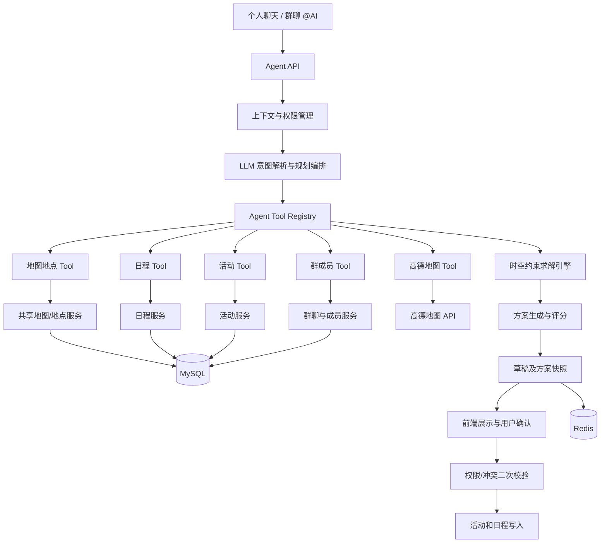
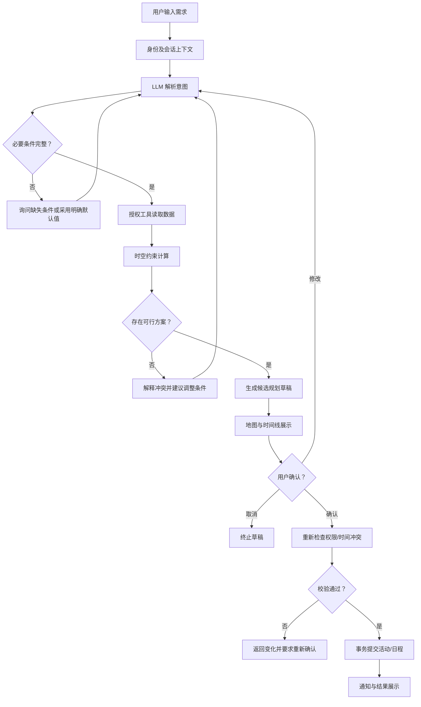

# 时空协同 Agent 开发计划（V1.0）

**项目：校园地图共建与社交平台**

**模块名称：Spatiotemporal Agent（时空协同智能体）**

**开发日期：2026-10-15**

**开发定位：从 AI 活动规划助手升级为个人与群体时空协同智能体**

---

# 一、项目定位

## 1.1 核心理念

传统日程应用解决的是“什么时候有事”。

地图应用解决的是“地点在哪里”。

活动应用解决的是“组织什么活动”。

聊天应用解决的是“人与人如何沟通”。

本项目希望利用 AI Agent 将上述系统连接起来：

**用户只需通过自然语言描述意图，Agent 就可以结合用户及授权群体的空间、时间与活动信息，生成可执行的安排。**

例如：

> 我和室友周六想出去玩，看看我们共同地图里收藏的地方，找一个大家都有空的下午，安排三个地点，尽量减少路上的时间。

Agent 需要：

1. 识别参与成员。
2. 查询相关成员授权共享的空闲时间。
3. 查询共同地图中的地点。
4. 读取地点介绍、备注和收藏信息。
5. 查询已经安排的活动。
6. 调用高德地图计算交通时间。
7. 计算可行的活动时间窗口。
8. 综合成员偏好生成多种方案。
9. 展示时间线和地图路线。
10. 经用户确认后创建活动、日程与行程。

整个流程从“询问建议”升级为“理解约束、制定计划、执行操作”。

## 1.2 产品定位

建议使用以下名称：

**产品功能名：时空协同智能体**

**技术模块名：Spatiotemporal Agent**

**比赛介绍表述：**

面向校园熟人社交与群体协作场景，构建融合共享地理空间、群体日程、活动组织及实时交通信息的时空协同智能体。系统通过自然语言交互感知用户意图，基于多源数据聚合、时空约束求解及智能工具调用，实现个人行程规划、多人时间协调、活动智能组织与地图联动执行。

## 1.3 创新重点

| 创新方向 | 具体价值 |
|---|---|
| 个人与群体的时空记忆 | 将地点备注、收藏、活动及日程转化为规划上下文 |
| 多人时空协同 | 不只找共同空闲时间，还判断地点与交通是否可行 |
| 熟人关系驱动的地点推荐 | 优先利用朋友和群体共同积累的地点 |
| 自然语言驱动操作 | 用户提出意图，Agent 生成方案并执行 |
| 地图与日程联动 | 地点改变时自动重新计算交通与日程 |
| 可解释规划 | 清晰展示为什么选择某个时间、地点与方案 |

重点需要强调：

**创新不是简单接入大模型 API，而是 AI 如何调用系统工具，完成跨业务数据的协调与执行。**

---

# 二、整体功能设计

## 2.1 三种 Agent 工作模式

### 模式一：个人智能规划

Agent 为单个用户制定安排。

示例：

> 明天下午有三个小时空闲，我想找一个安静的地方学习，再顺路买点东西。

执行逻辑：

- 查询个人日程。
- 找到可用的三小时。
- 查询个人收藏地图与历史地点。
- 结合地点备注、关键词和偏好筛选。
- 查询位置与交通时间。
- 根据时间预算生成路线。
- 用户确认后写入个人日程。

### 模式二：群聊协同规划

Agent 服务于一个聊天群体。

示例：

> @AI 帮我们安排周日的聚餐，找大家都没课的时间，优先选择我们群地图里收藏的餐厅。

执行逻辑：

- 获取当前群聊身份与群成员。
- 查询成员授权共享的空闲时间。
- 计算共同空闲时间窗口。
- 读取当前群体的共享地图。
- 查询合适的餐厅。
- 根据成员位置（仅在授权情况下）、交通方式及时间计算成本。
- 生成候选方案。
- 群成员选择方案。
- 经有权限的用户确认后创建群活动，并通知成员。

需要注意：

群聊里的所有成员不一定自动成为活动参与者，Agent 必须识别明确指定的成员或请求补充。

### 模式三：活动智能执行

Agent 基于已有活动进行调整。

示例：

> 我们周六的活动提前一个小时，帮我看看路线和其他日程有没有冲突。

Agent：

- 查询活动信息。
- 获取参与者及相关日程。
- 检测时间冲突。
- 重新计算交通。
- 生成变更方案。
- 展示变更影响。
- 确认后执行调整。

第一版优先实现前两种模式。第三种在基础能力稳定后加入。

---

# 三、系统整体架构

## 3.1 总体架构



## 3.2 核心设计原则

采用以下分工：

| 组件 | 职责 |
|---|---|
| LLM | 理解自然语言、拆分任务、选择工具、解释结果 |
| Tool Registry | 统一管理 Agent 能调用的业务能力 |
| 业务服务 | 查询地图、成员、地点、活动与日程 |
| 时空约束引擎 | 计算空闲时间、时间冲突、路线可行性 |
| 方案评分器 | 对多个可行方案排序 |
| Redis | 草稿缓存、会话状态、短期工具结果缓存 |
| MySQL | 保存正式业务数据及需要持久化的规划记录 |
| 前端 | 展示对话、地图、多方案、日程及确认界面 |

**大模型不直接负责时间计算，也不直接操作数据库。**

大模型负责理解和编排，确定性算法负责约束判断，现有业务服务负责数据访问和写入。

这是整个架构最重要的技术原则。

---

# 四、业务数据整合

## 4.1 Agent 可以使用的数据

| 数据来源 | 读取内容 | 主要用途 |
|---|---|---|
| 个人地图 | 个人保存的地点、备注、收藏 | 个性化规划 |
| 共享地图 | 群体共同保存的地点 | 群活动规划 |
| 地点详情 | 经纬度、地址、描述、标签 | 地点筛选与路线规划 |
| 个人日程 | 忙闲时间、事件类型、时间范围 | 时间冲突判断 |
| 群体日程 | 授权成员的忙闲状态 | 多人共同空闲计算 |
| 活动模块 | 活动时间、地点、参与状态 | 避免重复安排 |
| 群成员模块 | 群成员、角色、参与关系 | 确定规划对象 |
| 高德地图 | POI、地理编码、路径和耗时 | 空间规划 |
| 用户偏好 | 出行方式、地点类型、时间偏好 | 个性化排序 |

第一阶段优先复用现有字段。

例如地点表已有：

```sql
place (
    id,
    title,
    description,
    longitude,
    latitude,
    address,
    creator_id,
    created_at
)
```

那么 `description` 可以暂时作为 Agent 可理解的地点备注。

不需要一开始就引入新的记忆数据库。

## 4.2 地点数据增强

未来可增加：

```text
place
 ├── id
 ├── title
 ├── description
 ├── longitude
 ├── latitude
 ├── address
 ├── tags
 ├── estimated_visit_minutes
 └── created_at
```

新增字段建议：

| 字段 | 说明 |
|---|---|
| tags | 学习、餐饮、娱乐、购物等 |
| estimated_visit_minutes | 建议停留时长 |
| place_note | 可选的用户私有备注 |
| visibility | 如果地点自身需要独立可见性控制 |

**特别注意：同一个地点对不同用户可能有不同意义。**

例如：

地点：图书馆。

用户 A 的备注：

> 三楼比较安静，适合写代码。

用户 B 的备注：

> 晚上经常没有座位。

可以采用独立的 `place_note` 表，在不改变地点公共信息的情况下存储用户或群体的个性化备注。

Agent 查询时必须区分公共信息与个人私有备注。

## 4.3 日程数据统一

建议建立统一的 Agent 忙闲视图，而不是让 Agent 分别理解多个模块的底层表。

定义：

```java
public record BusyInterval(
    Long userId,
    Instant startTime,
    Instant endTime,
    String sourceType,
    Long sourceId
) {}
```

可能的数据来源：

- 个人日程。
- 已确认参与的活动。
- 用户主动标记的忙碌时间。
- 未来接入的外部日历。

注意区分活动状态：

- 已报名且确认参与：根据业务规则占用时间。
- 仅被邀请：默认不直接占用时间。
- 尚未报名：不占用。
- 已取消：不占用。
- 待确认：可单独作为风险提示。

**避免同一个活动同时存在于日程与活动表时被重复计算。**

统一视图通过 `sourceType + sourceId` 去重。

---

# 五、时空约束求解引擎

这是本项目区别于普通聊天 Agent 的核心技术模块。

## 5.1 时间约束

包含：

**硬约束：**

- 已经存在的忙碌日程。
- 明确的最早和最晚时间。
- 活动必须满足的时长。
- 人员必须全部有空。
- 必须按顺序完成的任务。

**软约束：**

- 更喜欢下午。
- 希望少走路。
- 希望活动不要太晚。
- 希望优先选择收藏地点。
- 尽可能让更多人参与。

硬约束必须满足，软约束用于排序。

## 5.2 多人共同空闲计算

假设：

```text
规划时段：14:00 - 20:00

成员 A 忙碌：15:00 - 16:00
成员 B 忙碌：17:00 - 18:00
成员 C 忙碌：19:00 - 20:00
```

首先合并成员的忙碌区间：

```text
15:00 - 16:00
17:00 - 18:00
19:00 - 20:00
```

再从规划范围扣除：

```text
14:00 - 15:00
16:00 - 17:00
18:00 - 19:00
```

如果活动要求持续 90 分钟，则以上没有符合要求的连续时间窗口。

Agent 应返回：

> 当前三位成员不存在共同空闲的连续 90 分钟。可以缩短活动时间、扩大日期范围，或由部分成员参加。

不能强行生成与已有日程冲突的计划。

算法建议：

1. 根据授权范围读取忙碌区间。
2. 裁剪到用户指定的规划时间窗口。
3. 按起始时间排序。
4. 合并重叠的忙碌区间。
5. 计算忙碌区间的补集。
6. 筛选长度满足活动需求的空闲区间。

第一版使用区间排序与合并算法即可。

## 5.3 空间约束

用户提到多个地点时，Agent 必须考虑实际交通时间。

例如：

> 下午先去打印店打印材料，再去图书馆学习两小时。

假设高德返回的预计耗时为：

```text
当前起点 → 打印店：15 min
打印店停留：10 min
打印店 → 图书馆：20 min
图书馆学习：120 min
```

那么总耗时：

```text
15 + 10 + 20 + 120 = 165 min
```

再增加适当缓冲时间。

需要区分：

- 步行。
- 驾车。
- 公共交通。
- 骑行（仅在所选接口支持时）。
- 用户未提供交通方式。

有明确任务顺序时不能随意改变顺序。

无顺序要求时可以比较不同地点访问顺序的总耗时。

## 5.4 时空联合计算

不能分别计算时间和空间后直接拼接结果。

例如用户在 16:00 有课程。

Agent 安排：

```text
14:00 - 15:30  图书馆学习
15:30 - 16:00  去教学楼
16:00 - 17:30  上课
```

如果实际交通需要 40 分钟，那么该安排不成立。

正确约束是：

```text
活动结束时间
+ 地点间交通时间
+ 缓冲时间
<= 下一项固定日程开始时间
```

同理，安排新的任务时也要考虑从上一项固定日程到新地点的交通时间。

这意味着：

**Agent 的日程安排需要同时满足时间区间、地点转换和任务持续时长三个条件。**

## 5.5 多方案评分

先排除违反硬约束的方案，再对剩余方案评分。

建议初期采用可解释的加权评分：

```text
Score =
    0.35 × 时间匹配度
  + 0.25 × 地点偏好匹配度
  + 0.20 × 交通便利度
  + 0.15 × 成员参与匹配度
  + 0.05 × 活动紧凑度
```

所有指标标准化为 0～1。

权重初期固定，后续允许按用户偏好调整。

每次生成 2～3 个候选方案即可。

例如：

- 方案 A：最节省交通时间。
- 方案 B：优先访问收藏地点。
- 方案 C：最符合成员时间偏好。

不需要第一版就引入强化学习或复杂智能优化算法。

---

# 六、Agent 工具系统设计

## 6.1 Agent 不直接访问数据库

建议建立 Tool Registry，统一向 Agent 暴露受控工具。

工具负责调用 Spring Boot 内部已有 Service。

第一版建议提供以下工具：

| Tool | 功能 |
|---|---|
| `get_my_schedule` | 查询个人日程 |
| `get_group_availability` | 查询群体共同空闲时间 |
| `search_saved_places` | 查询个人/共享地图地点 |
| `get_place_detail` | 获取地点详情与授权备注 |
| `get_activity_info` | 查询已有活动 |
| `get_route_duration` | 高德路径及耗时查询 |
| `search_amap_poi` | 搜索外部地点 |
| `create_plan_draft` | 保存规划草稿 |
| `commit_plan` | 校验确认后提交规划 |

其中 `commit_plan` 不应由模型自行完成最终授权。

必须由后端核验用户明确确认的草稿版本，才允许执行写入。

## 6.2 Tool 示例

```java
public interface AgentTool {

    String getName();

    String getDescription();

    Object execute(
        AgentExecutionContext context,
        Map<String, Object> arguments
    );
}
```

上下文示例：

```java
public record AgentExecutionContext(
    Long userId,
    Long groupId,
    String conversationId,
    String requestId
) {}
```

注意：

`userId` 和 `groupId` 必须由后端认证和会话上下文确定。

不能直接信任大模型生成的用户身份。

## 6.3 工具调用原则

1. 优先复用现有业务 Service。
2. 不开放任意 SQL 执行。
3. 工具只返回当前用户有权读取的数据。
4. 工具必须限制查询范围、返回数量和超时。
5. 写入工具需要显式确认与权限验证。
6. 工具调用记录到审计日志。
7. 地点备注、聊天内容和第三方返回文本均视为不可信内容，不得作为系统指令执行。

---

# 七、Agent 工作流设计

## 7.1 核心流程



## 7.2 意图理解

输入：

> 帮我们周六下午找个地方聚餐，最好大家都方便，两个小时左右。

期望结构：

```json
{
  "intent": "GROUP_ACTIVITY_PLAN",
  "participants": {
    "source": "CURRENT_GROUP",
    "memberIds": []
  },
  "timeConstraint": {
    "date": "待解析的目标周六",
    "preferredPeriod": "AFTERNOON"
  },
  "activity": {
    "type": "DINING",
    "durationMinutes": 120
  },
  "locationPreference": {
    "preferSharedMap": true
  },
  "transportMode": "UNKNOWN"
}
```

相对日期必须按照后端提供的当前时区与日期解析。

模型输出的结构化数据需要 Schema 校验。

## 7.3 Agent 记忆

建议分为三层。

### 第一层：对话记忆

用于理解当前对话里的上下文。

例如：

> 不要去上次那家店。

此时需要知道上次推荐的地点。

存储：Redis 短期会话状态，必要时持久化会话记录。

### 第二层：业务记忆

直接来自真实业务数据库：

- 地点。
- 地点备注。
- 共享地图。
- 日程。
- 活动。
- 成员关系。

**这是第一版最重要的记忆来源。**

不建议将日程、群成员和活动状态单独长期复制进向量数据库作为权威数据，因为这些信息变化频繁。

### 第三层：长期偏好记忆

后续加入：

- 常用交通方式。
- 常去地点。
- 偏好活动时段。
- 常见活动持续时长。
- 用户主动保存的规划偏好。

必须允许用户查看、更正和删除此类偏好。

第一阶段可以先使用普通 MySQL 表，无须急于加入 RAG。

---

# 八、个人与群体权限机制

## 8.1 数据访问权限

这是必须在第一阶段落实的模块。

不能因为用户邀请 Agent 加入群聊，就允许 Agent 读取所有成员的私人日程。

建议权限等级如下：

| 权限等级 | 允许访问 |
|---|---|
| PRIVATE | 仅本人可查看 |
| FREE_BUSY | 仅向授权对象提供忙闲状态 |
| DETAIL | 授权对象可查看具体日程 |
| GROUP_SHARED | 按当前群体的授权策略共享 |

默认建议：

**群体规划只读取共同规划所需的忙闲状态，不暴露日程标题、地点和具体内容。**

例如：

允许输出：

> 周六 15:00～17:00，有两名成员无法参加。

不应该输出：

> 张三 15:00 要去医院，李四 16:00 有私人约会。

除非相关成员主动授权公开相应详情。

## 8.2 授权流程

群聊 Agent 调用日程工具时：

1. 确认发起者属于当前群体。
2. 确认目标成员身份。
3. 检查每位成员的日程共享权限。
4. 获取允许共享的忙闲数据。
5. 对未授权成员标记 `UNKNOWN`。
6. 输出规划时明确说明可用性覆盖范围。

不能把“未授权”视为“有空”。

如果部分成员未授权，可以生成暂定方案，但不能声称所有成员都有空。

## 8.3 写入权限

个人安排：

- 本人确认后创建个人日程。

群体安排：

- 发起者根据群组权限创建群活动。
- 不能未经成员同意替其创建已确认的私人日程。
- 可以发送活动邀请。
- 成员通过报名或接受邀请后再同步到个人日程。

---

# 九、数据库设计

第一版采用增量扩展，不推翻现有业务模型。

## 9.1 优先复用

- `place`
- `map`
- `map_place`
- `map_member`
- 已有活动及活动成员表
- 已有群聊和群成员表
- 已有日程表（如存在）

需要根据当前仓库实际结构确定字段名，不能直接假设已有模块不存在。

## 9.2 建议新增的数据结构

### agent_session

保存会话：

```text
id
user_id
group_id
session_type
created_at
updated_at
```

### agent_message

保存会话消息：

```text
id
session_id
role
content
created_at
```

敏感内容应按最小必要原则存储，并配置保留和删除策略。

### agent_plan

保存规划草稿：

```text
id
session_id
creator_id
group_id
intent
status
plan_json
version
expires_at
created_at
updated_at
```

状态：

```text
DRAFT
AWAITING_CONFIRMATION
CONFIRMING
COMMITTED
FAILED
CANCELLED
EXPIRED
```

### agent_execution

保存执行记录：

```text
id
plan_id
request_id
operator_id
action_type
execution_status
result_json
created_at
```

用于：

- 追踪创建结果。
- 避免重复提交。
- 审计工具执行。
- 判断是否需要补偿操作。

### schedule_share_permission

如果现有日程模块尚未支持，可新增：

```text
id
owner_user_id
target_type
target_id
permission_level
created_at
```

其中：

```text
target_type = USER / GROUP
```

权限应支持撤销，并在每次读取和提交时重新校验。

## 9.3 持久化与缓存原则

MySQL 保存：

- 正式日程。
- 正式活动。
- 规划草稿。
- 执行记录。
- 用户授权与偏好。

Redis 保存：

- 当前会话上下文。
- 临时工具查询结果。
- 高频地点查询缓存。
- 短期路线耗时缓存。
- 必要的幂等与并发控制状态。

路线缓存应包含出行方式、起终点及时间条件等关键参数。

---

# 十、后端模块规划

建议在现有 Spring Boot 项目中增加：

```text
agent/
├── controller/
│   ├── AgentChatController
│   └── AgentPlanController
│
├── service/
│   ├── AgentOrchestrator
│   ├── AgentSessionService
│   ├── AgentPlanService
│   └── AgentCommitService
│
├── tool/
│   ├── AgentToolRegistry
│   ├── ScheduleTool
│   ├── GroupAvailabilityTool
│   ├── PlaceSearchTool
│   ├── ActivityTool
│   └── AmapRouteTool
│
├── planner/
│   ├── TimeConstraintSolver
│   ├── SpatialConstraintSolver
│   ├── PlanCandidateGenerator
│   ├── PlanScorer
│   └── PlanValidator
│
├── llm/
│   ├── DashScopeClient
│   ├── AgentPromptBuilder
│   └── AgentResponseParser
│
├── model/
│   ├── AgentIntent
│   ├── PlanningContext
│   ├── PlanningConstraint
│   ├── PlanningCandidate
│   └── PlanDraft
│
├── mapper/
└── config/
```

这是逻辑分层建议，具体包结构应与现有项目保持一致。

## 10.1 LLM 选型

沿用：

**通义千问 DashScope OpenAI 兼容接口**

先使用支持工具调用的模型实现编排。

建议：

- 服务端控制工具白名单。
- 控制最大工具调用轮次。
- 为大模型请求设置超时与费用预算。
- 将工具返回数据结构化、裁剪后送入上下文。
- 使用流式输出。
- 不允许模型凭空伪造活动、时间空档和路线耗时。

## 10.2 Agent 调度方式

初期使用单 Agent + Tool Calling。

不需要立刻引入复杂的 Multi-Agent 框架。

核心链路：

```text
User Message
    ↓
AgentOrchestrator
    ↓
LLM Tool Calling
    ↓
业务 Tool
    ↓
PlanningContext
    ↓
时空约束引擎
    ↓
候选方案
    ↓
LLM 解释
    ↓
SSE 输出
```

后续如果出现明确的复杂协同需求，再考虑将地点筛选、时间协调和行程生成拆分为独立规划器。

---

# 十一、前端交互设计

## 11.1 入口设计

建议三个入口：

**入口 A：个人 Agent**

在用户个人地图或日程界面提供 AI 按钮。

**入口 B：群聊 Agent**

在现有群聊输入：

```text
@AI 帮我们规划周六的活动
```

通过 WebSocket 或群聊现有消息链路触发 Agent。

**入口 C：活动详情 Agent**

在活动详情页面：

```text
AI 优化行程
```

对已有活动进行调整建议。

## 11.2 结果展示

Agent 不只输出 Markdown 文本。

应该输出结构化规划：

```text
AI 规划方案
├── 方案简介
├── 参与人员
├── 日期与时间
├── 时间线
├── 地图路线
├── 预计交通耗时
├── 使用的共享地点
├── 冲突与限制说明
└── 确认 / 修改 / 取消
```

建议界面分为：

- 左侧：AI 对话。
- 右侧：高德地图。
- 下方或侧边：时间线与规划方案。

手机端可以切换“对话 / 地图 / 日程”标签。

## 11.3 地图联动

当 Agent 返回：

```json
{
  "stops": [
    {
      "placeId": 101,
      "arrivalTime": "14:00",
      "durationMinutes": 60
    },
    {
      "placeId": 205,
      "arrivalTime": "15:30",
      "durationMinutes": 90
    }
  ]
}
```

前端应该：

1. 高亮相关地点。
2. 绘制地点之间的路线。
3. 按顺序显示地点编号。
4. 点击时间线定位到地图地点。
5. 点击地图点位显示对应活动步骤。
6. 允许用户要求重新规划。

地图前端继续复用 Vue3 + 高德 JS SDK。

路线耗时由后端统一查询，避免前后端形成两套规划结果。

---

# 十二、接口设计

## 12.1 Agent 对话

```http
POST /api/agent/chat/stream
```

参数：

```json
{
  "sessionId": null,
  "scope": "GROUP",
  "groupId": 1001,
  "message": "帮我们规划周六下午的聚餐"
}
```

建议 SSE 事件类型：

```text
message_delta
tool_status
plan_created
error
done
```

群聊场景可通过现有 WebSocket 广播最终规划卡片；私人授权数据和工具执行明细不应直接广播到整个群。

## 12.2 查询草稿

```http
GET /api/agent/plans/{planId}
```

返回规划版本、状态、可见范围、时间线、地点和候选方案。

## 12.3 修改规划

```http
POST /api/agent/plans/{planId}/revise
```

例如：

```json
{
  "instruction": "把第二个地点换成更近的"
}
```

修改后的草稿版本递增。

## 12.4 确认规划

```http
POST /api/agent/plans/{planId}/confirm
```

请求：

```json
{
  "version": 3,
  "selectedCandidateId": "candidate-2",
  "idempotencyKey": "client-generated-unique-id"
}
```

后端需要：

- 校验 JWT。
- 校验用户权限。
- 校验规划版本。
- 校验草稿是否过期。
- 重新检查日程和活动冲突。
- 执行事务写入。
- 返回创建的活动和日程 ID。

第三方接口调用不要放在长时间数据库事务中。

如果跨多个业务服务执行，应设计执行状态记录和失败补偿机制。

---

# 十三、规划结果的数据格式

推荐统一定义 `PlanningCandidate`。

```json
{
  "candidateId": "candidate-1",
  "title": "周六下午校园活动",
  "participants": [101, 102, 103],
  "timeZone": "Asia/Shanghai",
  "startTime": "2026-10-17T14:00:00+08:00",
  "endTime": "2026-10-17T18:00:00+08:00",
  "transportMode": "WALKING",
  "stops": [
    {
      "placeId": 201,
      "title": "图书馆",
      "arrivalTime": "14:00",
      "leaveTime": "15:30",
      "durationMinutes": 90
    },
    {
      "placeId": 202,
      "title": "咖啡店",
      "arrivalTime": "16:00",
      "leaveTime": "17:30",
      "durationMinutes": 90
    }
  ],
  "totalTravelMinutes": 30,
  "availableMembers": 3,
  "unverifiedMembers": 0,
  "constraintStatus": "FEASIBLE",
  "score": 0.89
}
```

以上数字仅用于说明数据结构，不代表已经查询到的真实活动或路线。

正式实现还应包含：

- 每段交通耗时来源。
- 数据查询时间。
- 地点坐标及坐标系。
- 约束检查结果。
- 规划生成版本。
- 可能的风险和不确定性。

---

# 十四、关键可靠性设计

## 14.1 防止日程竞争

问题：

Agent 在 14:00 查询到成员有空。

但在 14:02 成员新增了日程。

如果直接提交，可能产生冲突。

解决：

**规划时检查一次，最终提交时再次检查。**

提交时需要：

1. 获取当前有效日程。
2. 重新执行约束校验。
3. 通过数据库锁或版本机制防止并发冲突。
4. 在同一事务中完成校验及业务写入。

仅靠“提交前查一次”不足以避免并发竞态。

## 14.2 防止重复创建

例如用户连续点击确认按钮。

必须采用：

```text
planId + idempotencyKey
```

建立幂等约束。

同一请求重复提交应返回已有结果，而不是再次创建活动。

## 14.3 防止模型幻觉

模型可能生成：

> 这家店营业到晚上十点。

但系统并没有查询到营业时间。

要求：

- 真实营业信息必须来自可信数据源。
- 不确定时标记未知。
- 交通耗时不能由模型编造。
- 日程状态必须来自授权业务服务。
- 规划引擎必须在最终展示前验证结构化结果。

## 14.4 地理坐标一致性

现有地点主存仍在 MySQL。

Agent 与高德地图交互时必须明确坐标系：

- 高德地图使用 GCJ-02。
- 外部数据可能为 WGS84。
- 业务库必须约定坐标存储标准。
- 路线请求与前端渲染需在正确的坐标系下执行。

不能直接混用不同坐标系。

---

# 十五、分阶段开发计划

## P0：基础业务打通

**目标：让 Agent 真正理解现有系统数据。**

任务：

- [ ] 梳理现有地图、地点、活动、日程和群聊模块。
- [ ] 确认日程数据是否已有完整的 CRUD。
- [ ] 实现 `AgentExecutionContext`。
- [ ] 实现 Tool Registry。
- [ ] 封装个人日程读取工具。
- [ ] 封装共享地图地点读取工具。
- [ ] 封装活动查询工具。
- [ ] 封装群成员读取工具。
- [ ] 对工具统一增加权限验证。
- [ ] 完成通义千问 Tool Calling 集成。

验收：

Agent 可以正确回答：

> 我明天下午有些什么安排？

> 我们群地图上有哪些适合学习的地点？

并且不会读取无权访问的数据。

## P1：个人时空规划 MVP

**目标：完成个人时间 + 地点 + 路线的协同规划。**

任务：

- [ ] 实现用户意图解析。
- [ ] 实现时间区间合并与空闲检测。
- [ ] 实现高德路径耗时查询。
- [ ] 支持地点停留时长。
- [ ] 实现基本时空约束求解。
- [ ] 生成 2～3 个候选方案。
- [ ] 实现 Agent SSE 流式输出。
- [ ] 实现草稿保存及确认。
- [ ] 实现创建个人日程。
- [ ] 前端实现规划卡片和地图联动。

验收场景：

> 明天下午想花两小时学习，再去吃饭，帮我选一个不冲突的安排。

要求返回：

- 合法时间。
- 推荐地点。
- 交通耗时。
- 时间线。
- 可以确认创建的草稿。

## P2：群体协同规划

**目标：完成真正的多人协调能力。**

任务：

- [ ] 实现群体 Agent 上下文。
- [ ] 对接 WebSocket 群聊。
- [ ] 支持 `@AI`。
- [ ] 实现群成员授权查询。
- [ ] 实现 Free/Busy 权限控制。
- [ ] 实现多人共同空闲计算。
- [ ] 集成群体共享地图。
- [ ] 生成多人活动规划。
- [ ] 支持确认创建现有活动。
- [ ] 支持向相关成员发送邀请。
- [ ] 群聊展示结构化方案卡片。

验收场景：

> @AI 我们三个周末想出去玩，帮我们找到都有空的下午，优先去共享地图里的地方。

要求：

- 识别指定成员。
- 查询授权空闲时间。
- 推荐共享地点。
- 计算路线。
- 创建活动草稿。
- 经确认后创建群活动。

**建议将 P2 作为机设比赛重点演示阶段。**

## P3：智能调整与执行

任务：

- [ ] 支持修改已有规划。
- [ ] 支持活动改期建议。
- [ ] 日程改变后重新检查草稿。
- [ ] 实现草稿版本控制。
- [ ] 实现提交幂等。
- [ ] 加入失败补偿及审计。
- [ ] 支持更加灵活的地点筛选。
- [ ] 支持成员偏好和方案对比。

验收：

> 我临时有事，活动推迟一个小时还能不能进行？

Agent 能重新检查人员时间、路线及其他活动，并在获得适当授权后提交调整。

## P4：高级能力（比赛增强项）

以下内容不建议抢在 MVP 前面开发：

- [ ] 基于用户历史行为学习偏好。
- [ ] 地点备注语义检索。
- [ ] RAG 地点知识检索。
- [ ] 长期偏好记忆。
- [ ] 多日复杂行程规划。
- [ ] 多交通方式联合优化。
- [ ] 动态天气和环境因素。
- [ ] 群体投票与偏好协调。
- [ ] 规划质量反馈闭环。

---

# 十六、测试与验收

## 16.1 功能测试

| 测试项目 | 预期结果 |
|---|---|
| 个人空闲查询 | 正确返回空闲时间 |
| 多人空闲交集 | 不将忙碌时段识别为空闲 |
| 日程重叠 | 拒绝冲突方案 |
| 交通时间不足 | 拒绝不可行路线 |
| 共享地图查询 | 只返回授权地点 |
| 成员未授权 | 不泄露私人日程 |
| 地点无法查询 | 说明不确定性 |
| 高德请求失败 | 返回降级信息，不伪造真实耗时 |
| 用户修改规划 | 正确生成新版本 |
| 重复点击确认 | 不重复创建活动 |
| 提交期间日程变化 | 重新校验并反馈冲突 |
| 模型错误 Tool 参数 | 拒绝非法调用 |
| 群聊提示词注入 | 不越权读取或写入 |

## 16.2 性能测试

重点记录：

- Agent 首字响应时间。
- 工具调用次数。
- 地图 API 调用耗时。
- 时空求解耗时。
- 完整规划耗时。
- 每次任务 Token 消耗。
- 规划成功率。
- 方案约束满足率。

不建议只测 LLM 回答速度。

实际体验取决于外部 API、工具调用和规划计算的整体耗时。

## 16.3 规划效果评估

建议建立固定测试数据集。

至少包含以下场景：

1. 单人空闲时间规划。
2. 单人多地点连续规划。
3. 三人共同空闲规划。
4. 时间足够但交通不可行。
5. 地点满足偏好但成员无空闲。
6. 有空闲但部分成员未授权。
7. 提交时发生并发日程变化。
8. 外部地图 API 失败。

评估指标：

```text
硬约束满足率
有效方案生成率
冲突检测准确率
工具调用正确率
权限违规次数
平均规划耗时
用户方案采纳率
```

权限违规应作为必须为零的安全门槛。

---

# 十七、机设比赛展示方案

建议准备三个连续场景。

## 场景一：让 AI 理解地点

用户：

> 我们之前在共享地图里收藏了哪些适合小组讨论的地方？

Agent 查询群共享地图，结合地点备注筛选并在地图上标记。

展示能力：

**群体地理知识检索。**

## 场景二：让 AI 理解时间

用户：

> 我们周六下午什么时候都有空？

Agent 基于授权日程，找出共同空闲时间。

展示能力：

**多人时间协同。**

## 场景三：让 AI 自主规划并执行

用户：

> 那就帮我们规划一个下午的小组讨论，结束后一起吃饭，尽量去我们收藏过的地方。

Agent：

1. 复用前两轮对话上下文。
2. 获取共同空闲时段。
3. 获取地点和备注。
4. 计算交通耗时。
5. 生成候选路线与时间线。
6. 展示地图。
7. 用户选择方案。
8. 创建群活动。
9. 向成员发送邀请。

展示能力：

**跨业务系统的时空协同规划与可信执行。**

这三个场景能够清楚体现：

```text
地图共建
   +
群体社交
   +
日程协同
   +
Agent Tool Calling
   +
时空约束优化
   =
可执行的群体时空智能服务
```

---

# 十八、开发优先级与最终建议

## 必须完成

- Agent Tool Calling
- 现有地图地点读取
- 个人与群体日程读取
- 群成员权限控制
- 时空约束求解
- 高德路线耗时查询
- 规划草稿及确认
- 创建个人日程和群活动
- 地图与时间线联动

## 可以后置

- 向量数据库
- RAG
- 长期 AI 记忆
- Multi-Agent
- 强化学习
- 复杂路线最优化
- 天气预测
- 外部第三方日历接入

## 技术决策总结

| 技术问题 | V1 决策 |
|---|---|
| Agent 框架 | 先使用 Spring Boot 自实现编排与 Tool Calling |
| LLM | 通义千问 DashScope |
| 数据库 | MySQL 8 + MyBatis |
| 缓存 | Redis |
| 地理服务 | 高德地图 |
| 实时对话 | SSE |
| 群聊交互 | 复用 WebSocket |
| 时间求解 | 区间合并与空闲交集 |
| 空间求解 | 路径耗时 + 地点约束 |
| 方案排序 | 可解释加权评分 |
| 数据安全 | Service 权限验证 + Free/Busy |
| 执行方式 | 草稿 → 用户确认 → 二次校验 → 事务提交 |

---

# 十九、最终项目目标

最终系统不应该只是：

> “AI 帮我推荐去哪玩。”

而应该实现：

> “AI 知道我和朋友在授权范围内什么时候有空、共同地图里有哪些值得去的地方、每个地点有什么特点，以及地点之间需要多少时间，并能根据我们的目标自动生成可执行安排。”

系统形成三个层次：

**感知层：** 理解人、地点、日程、活动及用户意图。

**决策层：** 基于时间、空间、权限和偏好进行联合约束求解。

**执行层：** 将规划结果转化为真实活动、日程和地图行程，并支持后续调整。

最终形成：

**以群体共建地图为地理记忆基础，以日程与活动为业务上下文，以大模型为自然语言交互入口，以确定性时空约束引擎为决策保障的个人与群体时空协同智能体。**


---

# 二十、阶段执行补全（P0.5 / P1.5，2026-10-16 追加）

> 2026-10-15 版规划的 F～P2、G 阶段已全部完成。本章按评审结论补入两个阶段的执行落地，
> 补齐“群聊上下文 → 群体共建地图 → 地点语义理解 → 成员日程 → 空间与时间联合规划 → 创建活动”这一核心链路。

## 20.1 结论复述（评审采纳项）

- LLM 不负责判定活动在时间与空间上是否可行：候选地点/约束由模型提出，
  **交通时长、站点停留、日程冲突全部由后端确定性逻辑计算**。
- 三级候选来源固定为：GROUP_MAP（本群共建地图）→ PERSONAL_MAP（用户本人地图，需用户明确同意）→
  AMAP_POI（外部 POI，兜底）；来源必须标注，禁止把高德 POI 伪装成共建地点。
- 共建地图就是 Agent 的**空间记忆**：地点备注（place_comment，按 map 归属）参与语义检索与推荐依据。

## 20.2 P0.5：群聊关联地图读取与地点语义检索（已完成 2026-10-16）

- 新工具：`get_group_map_context` / `search_group_map_places` / `get_place_context`
  （`AgentToolkit`，群语境由后端 ThreadLocal 注入，禁止模型伪造 groupId/mapId）。
- 语义检索：`MapPlaceMapper.searchPlacesOnMaps`——地点名/简介/分类名/群备注四路 LIKE
  （全部 `#{}` 参数绑定 + `SqlLikeUtils.escapeLike`），地图范围硬过滤 + status=1；
  同一地点跨图聚合，备注保留 (mapId, content) 对应关系。
- 备注即证据：`get_place_context` 返回各张授权地图下的备注原文摘要，仅限当前语境授权范围，
  跨群数据零泄漏（验收用例：A 群语境读不到 B 群地点与备注）。
- 系统提示词从“信息优先级”升级为“空间优先级 + 来源标注”，POI 兜底需用户同意。

## 20.3 P1.5：确定性时空联合求解（已完成 2026-10-16）

- `SpatiotemporalPlanner`（纯函数，不触 DB/LLM）：
  FreeWindowSolver 共同空闲窗 → 候选受限排列枚举（≤4 地点，≤24 排列）→
  逐段 TravelInfoProvider 真实交通耗时（RouteCache 复用，无 key 退化估算并标注）→
  终点回流缓冲（缺省 10 分钟）→ 硬约束过滤 → 固定权重评分（共建优先 > 用户意图排序 > 余量 > 少绕路）→ Top-3。
- 新工具 `plan_itinerary`：日期窗口 + placeIds/keyword 二选一 + stayMinutes（缺省 60，可覆盖）+
  transportMode（WALK/RIDE/DRIVE，公交暂不支持）+ bufferMinutes；返回 coverage/unknownCount 与带精确站
  点时间线的方案；无解时返回原因与建议（换日期/减地点/缩短停留/换更近地点）。
- `plan_json` 扩展（全部可空，向后兼容）：groupId / sourceMapIds / selectedPlaceIds /
  availabilityCoverage / routeSegments / totalTravelMinutes / planningSourceVersion / constraintStatus / reason。
- 群聊 @AI 提交草稿时由后端**盖章**：groupId、sourceMapIds、selectedPlaceIds、逐站 source/sourceMapId、
  planningSourceVersion（地图+地点 id@updated_at 的 sha256 指纹）——模型不可自述来源。
- 续聊支持：群聊 @AI 注入 24h 内上一轮 AGENT 回复（截 800 字），
  支持“把第二个方案创建成活动”的跟进对话。

## 20.4 提交前二次校验（P2 强化，已完成 2026-10-16）

- `PlanValidator`：未知字段宽容解析；来源标签仅保留合法值；新增**站点间交通运输硬校验**
  —— 相邻两站实际交通耗时（重算覆写 routesegments/totalTravelMinutes）必须 ≤ 站点间隔，
  “两小时排三个地点”在提交口子被确定性拒绝。
- `PlanSaveService.save` 二次校验链：归属/幂等/版本防覆盖（原有）+
  ①发起者仍是群地图成员；②sourceMapIds/selectedPlaceIds 仍可访问；③planningSourceVersion
  与当前指纹一致（共建地图变化 → 409 要求重新生成）；④KNOWN 成员（除本人已建活动外）与
  活动窗口重叠 → 409 要求重新确认；⑤存在 UNKNOWN 成员 → constraintStatus=TENTATIVE（卡片必须明示）。
- `revise` 无变更守卫：等值修订不升版、不重置幂等标记，杜绝重复建档。

## 20.5 验收对照

| 场景 | 说明 | 载体 |
|---|---|---|
| A 共建地图检索 | 备注「适合讨论」命中咖啡店并引用真实备注 | GroupMapContextAcceptanceTest / phase-h-demo |
| B 时空联合规划 | 共同空闲 + 真实交通 + 停留 + 缓冲，三小时窗口边界两站可用/不可用均有判定 | SpatiotemporalPlannerTest / phase-h-demo |
| C 跨群权限隔离 | A 群语境读不到 B 群地图与备注、忙闲不可见 | GroupMapContextAcceptanceTest / phase-h-demo |
| D 活动创建 | 第二轮 @AI 续聊草稿 → 修订 → 保存建活动；重复确认不重复创建 | PlanItineraryAcceptanceTest / PlanSaveGroupRevalidationAcceptanceTest / phase-h-demo |

基线：改动前 66 例；新增 11 例（P0.5×2 + 求解器×5 + 链路×1 + 保存强化×2 + 隔离复验）全部绿。


## 20.6 终验修复落点（2026-10-16 复审采纳）

- 冲突谱系化：本人“其他”活动一律参与冲突判定，豁免仅限正在更新的同一活动（`lineageActivityId`，
  仅 revise 后端盖章可写入）；已保存草稿的真实修订默认走活动更新接口原地生效，另建活动显式 asNewDraft。
- routeConfidence：ESTIMATED 方案不得与高德实测方案同状态展示（卡片/助手页独立徽标）。
- 衔接校验：求解器 headBuffer（起点紧贴前忙闲 → 链条后推）+ 保存校验（相邻占用距活动首/尾 <10 分钟 → 409）。
- 指纹补齐群内备注变化（place_comment 最新 id+条数）。
- 群聊语境身份：agent 线程无 SecurityContext，`get_my_schedule/plan_itinerary` 走 GROUP_CONTEXT 发起人，
  草稿 referenceMapId 校验走显式 `getMapDetailAs(mapId, userId)`；AGENT 长回复截断 ≤1000 落库（正文全文在 ai_message）。
- 端到端实机：`tools/phase-h-demo.mjs` 场景 A–E 以真实 LLM + WS + 高德 + MySQL 全绿（.ai-run/phase-h-live-final.jsonl）。
