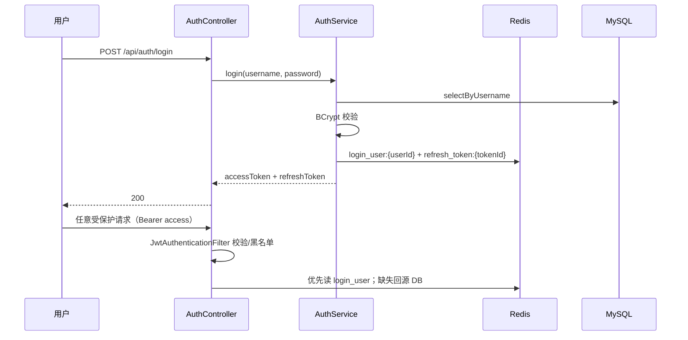
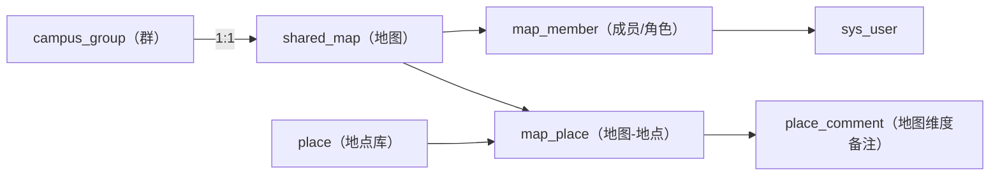
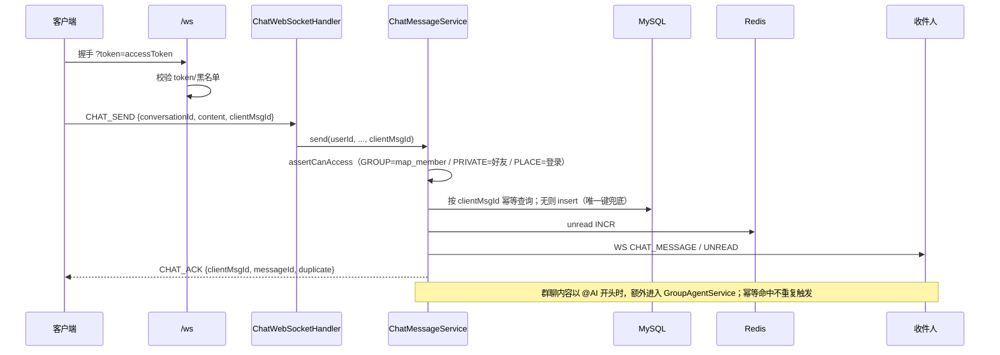
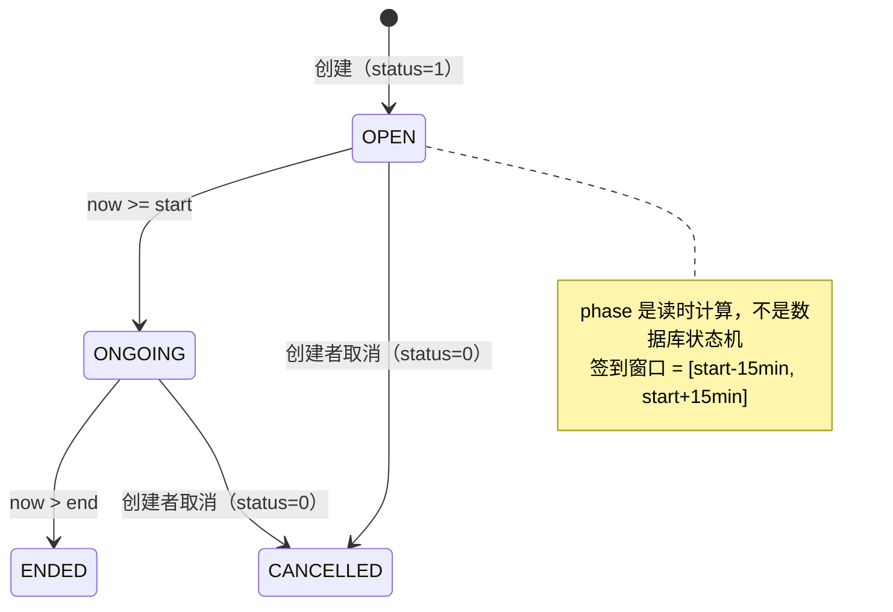
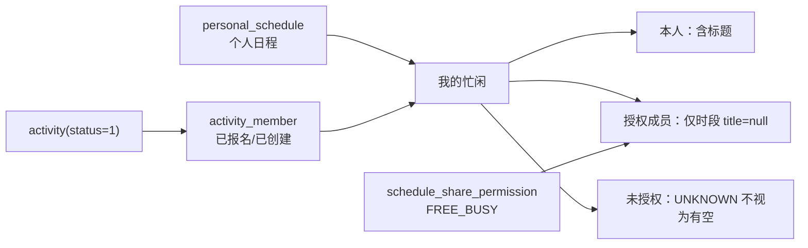
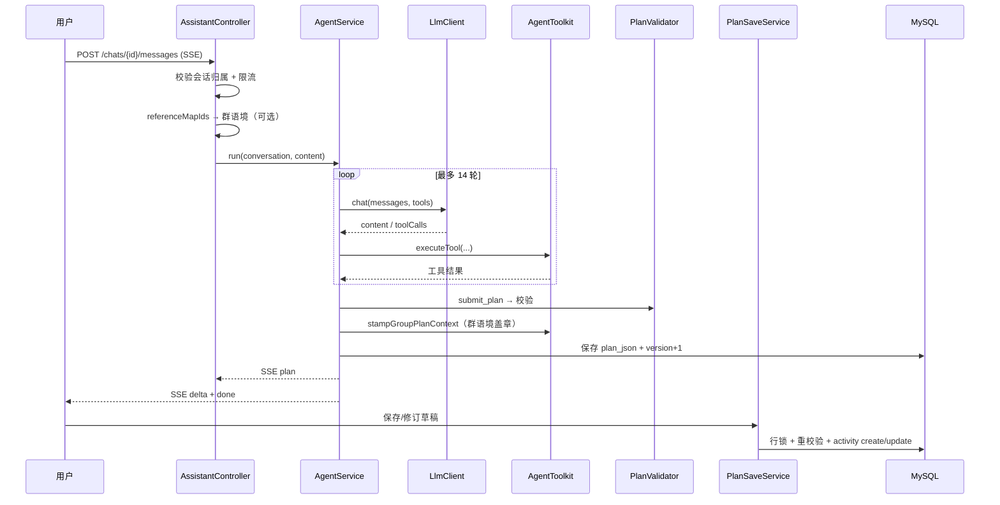
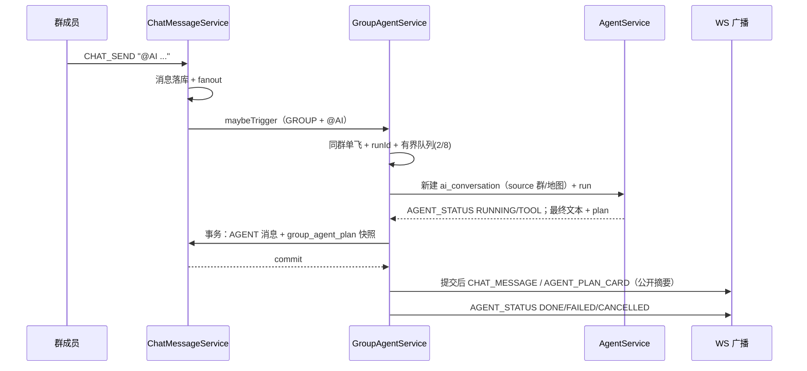
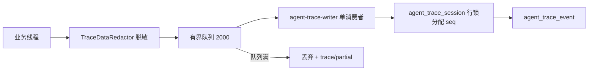
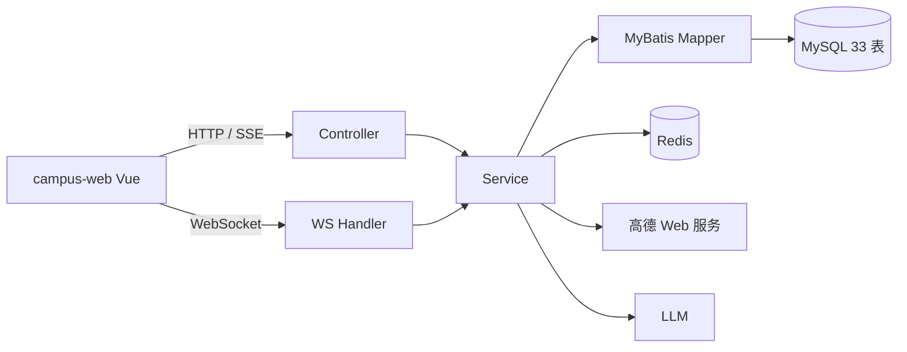
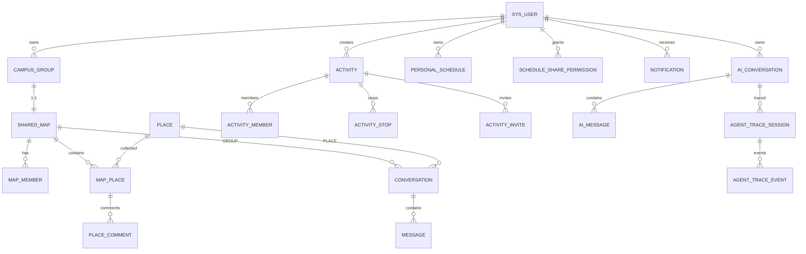

# 项目全流程说明

> 版本：2026-10-22  
> 范围：`campus-framework` + `campus-server` + `campus-web` + `tools/`  
> 口径：**以当前 `main` 分支代码为准**。旧文档中的数字、账号、接口如与本文冲突，以本文和代码为准。  
> 配套文档：[体验与流程问题清单](./体验与流程问题清单.md)、[Agent Trace 文档](./agent-trace/README.md)、[演示账号与数据总表](./演示账号与数据总表.md)。

---

## 目录

- [第 0 章 阅读说明、术语与角色](#第-0-章-阅读说明术语与角色)
- [第 1 章 操作文档：怎么跑、怎么进](#第-1-章-操作文档怎么跑怎么进)
- [第 2 章 用户操作流程](#第-2-章-用户操作流程)
- [第 3 章 业务流程](#第-3-章-业务流程)
- [第 4 章 数据流程](#第-4-章-数据流程)
- [第 5 章 已知限制与口径修正](#第-5-章-已知限制与口径修正)
- [第 6 章 附录](#第-6-章-附录)

---

## 第 0 章 阅读说明、术语与角色

### 0.1 这个项目是什么

三句话：

1. **校园协作应用**：同学建一张共享地图，收藏地点、写备注，在地点上发起活动，完成报名、召集、签到、提醒、去现场的闭环。
2. **实时社交**：地图地点变化、好友申请、聊天消息、活动召集/取消/临近开始，通过 WebSocket 推给在线用户。
3. **AI 活动规划**：用户用一句话描述需求，AI 查共建地图地点与备注、真实路线耗时、群成员忙闲，生成结构化多站行程草稿，确认后保存成真实活动。

### 0.2 术语表

| 术语 | 代码/数据位置 | 说明 |
|---|---|---|
| 活动 | `activity` | 有起止时间、地点、人数上限、签到码；可报名、邀请、签到、取消 |
| 个人日程 | `personal_schedule` | 用户私有日程；前端已支持增删改，并合并进统一日历 |
| AI 规划 / 计划 / 草稿 | `ai_conversation.plan_json` | 同一份结构化 JSON；本文统一叫「草稿」或「计划」 |
| 地图 | `shared_map` | 地点的集合，有 OWNER/EDITOR/VIEWER 成员角色 |
| 群 | `campus_group` | 与地图 **1:1**；群聊不是独立实体 |
| 群聊 | `conversation(type=GROUP)` | 与地图 1:1，`map_id` 绑定；首次打开时懒创建 |
| 地点聊天 | `conversation(type=PLACE)` | 按地点创建，登录用户即可加入 |
| 私聊 | `conversation(type=PRIVATE)` | 仅好友之间；双方都必须在 `conversation_member` |
| FREE_BUSY | `schedule_share_permission` | 忙闲授权：只共享时段，不共享标题/备注 |
| Trace | `agent_trace_session/event` | Agent 执行追踪，30 天保留，仅本人可见 |
| 签到窗口 | `activity.start_time ± 15min` | 当前代码实际口径：开始前 15 分钟至开始后 15 分钟 |

### 0.3 角色与权限矩阵

| 角色 | 能做什么 | 不能做什么 |
|---|---|---|
| 未登录 | 登录、注册、看公开地图详情（部分） | 任何写操作；访问受保护路由会跳 `/login` |
| 普通用户 USER | 建群/建图、加地点、评论、聊天、活动、日程、AI | 管理端接口 |
| 地图 OWNER | 改成员角色、移除成员、看邀请码、全部编辑权限 | 代成员授权忙闲 |
| 地图 EDITOR | 加/改/移地点、评论、发群消息、活动 | 改成员角色、看邀请码 |
| 地图 VIEWER | 查看地图/地点/评论、发群消息（按会话权限）、报名活动 | 加/改/移地点、改成员 |
| 活动创建者 | 编辑、取消、看成员、看签到码、邀请 | 代替成员签到 |
| 活动成员 | 看成员、签到（窗口内+码正确） | 编辑/取消活动 |
| 好友 | 私聊、看在线状态 | 看非公开地图 |
| AI 会话所有者 | 看/修订/保存自己的草稿、看自己的 Trace | 看别人的私有会话；群规划卡可看公开摘要，继续规划仅发起人 |

---

## 第 1 章 操作文档：怎么跑、怎么进

### 1.1 启动顺序

```bash
# 1) MySQL 8 + Redis 7
docker compose up -d

# 2) 后端（多模块，必须带 -pl campus-server -am）
mvn -pl campus-server -am spring-boot:run

# 3) 前端（另开终端）
npm --prefix campus-web run dev
```

| 服务 | 地址 | 说明 |
|---|---|---|
| 前端 | http://localhost:5173/ | 必须用 `localhost`；`127.0.0.1:5173` 可能打开机器上其他项目 |
| 后端 | http://localhost:8080 | Vite 已代理 `/api` 与 `/ws` |
| Swagger | http://localhost:8080/swagger-ui.html | 分组「脚手架基础设施 / 校园业务」 |
| 消息中心 | http://localhost:5173/messages | 通知/会话/好友申请/活动邀请；`/friends`、`/traces` 为辅助入口 |
| 执行追踪 | http://localhost:5173/traces | 账号菜单「开发者视图」；仅当前登录用户自己的 Trace |
| MySQL | localhost:3306 | `campus / campus123`，库 `campus` |
| Redis | localhost:6379 | 无密码 |

内存紧张时后端可加小堆参数：

```bash
MAVEN_OPTS="-Xmx512m" mvn -pl campus-server -am spring-boot:run \
  -Dspring-boot.run.jvmArguments="-Xms128m -Xmx768m"
```

改了后端代码必须重启；先找 PID 再杀：

```bash
netstat -ano | findstr :8080
taskkill //F //PID <pid>
```

### 1.2 账号与演示数据

| 用途 | 账号 | 密码 |
|---|---|---|
| 管理端/种子账号 | `admin` | `admin123` |
| 演示账号 | `demo01`–`demo20` | `demo1234` |

```bash
node tools/seed-demo.mjs               # 创建/补齐演示数据（按 demoKey 更新未来活动/日程）
node tools/seed-demo.mjs --verify-only # 只校验，不写入
node tools/seed-demo.mjs --reset-demo  # 预览 demoKey 种子记录（默认 dry-run）
node tools/seed-demo.mjs --reset-demo --apply # 重置后重新造数
node tools/demo-report.mjs --verify    # 校验每人地图、日程、忙闲授权
node tools/demo-report.mjs --out docs/演示账号与数据总表.md
node tools/verify-round3-scenarios.mjs # Map A 全员授权 + Map B 临时撤销/恢复
```

演示数据规模（2026-10-22）：3 张 `[DEMO]` 地图/群聊、16 个地点、38 条群/私聊消息、5 个活动、6 条动态、**40 条个人日程（20 人每人 2 条）**，20 人全部授予群忙闲。demo01/02/03 互为好友；demo05 向 demo01 留一条待处理好友申请供消息中心演示。

### 1.3 数据库迁移顺序

`db/migration/` 共 8 个脚本，存量库必须按顺序执行；全新库由 `schema.sql` 直接建全表。

| 顺序 | 脚本 | 作用 |
|---|---|---|
| 1 | `20261015_01__create_activity_stop.sql` | 活动多站行程 |
| 2 | `20261015_02__create_ai_tables.sql` | AI 会话/消息 |
| 3 | `20261016_01__create_personal_schedule.sql` | 个人日程 + 忙闲授权 |
| 4 | `20261018_01__add_ai_message_geo_json.sql` | AI 消息地图回放字段 |
| 5 | `20261019_01__create_agent_trace.sql` | Agent Trace 两张表 |
| 6 | `20261022_01__add_message_client_msg_id.sql` | 聊天消息 `client_msg_id` + 唯一键（断线重试幂等；存量库不执行会导致发消息报 Unknown column） |
| 7 | `20261022_02__add_group_agent_plan.sql` | 群规划快照表 + `ai_conversation.source_group_conversation_id/source_map_id`（第二轮群卡片共享） |
| 8 | `20261023_01__create_notification.sql` | 统一通知收件箱（唯一键 `(user_id, dedupe_key)`；不执行会导致启动前置检查 fail-fast） |

### 1.4 前端页面地图

| 路由 | 页面 | 主要功能 | 前置条件 |
|---|---|---|---|
| `/login` | `LoginView` | 登录、注册并自动登录 | 未登录；已有 token 会跳 `/` |
| `/` | `MapListView` | 我的地图、创建地图/群、邀请码加入 | 登录 |
| `/maps/:id` | `MapWorkspaceView` | 地图详情、成员、地点、评论、地点活动、群聊/地点聊天；`?chat=1` 自动打开群聊 | 登录 + 可见该地图；写操作需角色 |
| `/messages` | `MessagesView` | 通知收件箱、全局会话列表、好友申请、活动邀请；顶栏总角标 | 登录 |
| `/friends` | `FriendsView` | 搜索、加好友、处理请求、好友列表、私聊；`?chat={peerUserId}` 自动打开私聊 | 登录 |
| `/activities` | `ActivitiesView` | 日历、我的日程、收到的邀请、我创建的、忙闲共享、新建/编辑活动 | 登录 |
| `/assistant` | `AssistantView` | AI 个人规划、会话、参考地图、定位、草稿编辑/保存 | 登录 |
| `/conversations/:conversationId/plans/:planId` | `PlanDetailView` | 群规划公开摘要 + 公开站点地图/相邻路线回放 | 登录 + 群成员 |
| `/traces` | `TraceCenterView` | Trace 列表、详情、时间线/泳道、导出；入口在账号菜单「开发者视图」 | 登录；仅本人 |

顶栏固定为：地图 / 消息 / 日程 / AI 助手；右上角账号菜单含「好友」「开发者视图（/traces）」「退出」。「消息」角标只按服务端 summary 的 `未读通知 + 有未读的会话数` 显示。

### 1.5 最容易踩的运行问题

| 现象 | 原因/处理 |
|---|---|
| `127.0.0.1:5173` 打开别的项目 | 本项目 Vite 可能只绑 `[::1]`；用 `localhost:5173` |
| 8080 启动失败 | 旧后端进程仍在；`netstat` 找 PID 后 `taskkill` |
| 登录 500，日志 `Unable to connect to Redis` | Docker/Redis 未启动；`docker compose up -d` |
| 时间显示成 `[2026,10,22,...]` | 后端 `LocalDateTime` 以数组序列化；前端统一用 `toDate()` |
| 消息发不出去 | 消息只能走 WebSocket；没有 REST 发消息接口 |
| 高德 key/配额错误 | 路线接口硬失败，不会降级；超时/网络错误才会走直线估算 |
| 测试报 Docker 环境错误 | 先 `docker ps` 确认 Docker Desktop 引擎；Testcontainers 需要它 |

---

## 第 2 章 用户操作流程

> 本章是“屏幕级步骤”。每条流程都标出当前实际行为与边界；体验问题详见 [体验与流程问题清单](./体验与流程问题清单.md)。

### 2.1 登录、注册、退出、切换账号

1. 打开 `/login`，在「登录 / 注册」之间切换。
2. 输入用户名、密码；注册额外填昵称。
3. 点「登录」或「注册并登录」；成功后写入 `accessToken`/`refreshToken`，跳 `/`。
4. 退出：右上角账号菜单「退出」→ 清空本地存储与消息角标 → 回 `/login`。
5. 切换账号：退出后重新输入；账号菜单显示昵称与 `@username`，并提供好友/开发者视图入口。未登录访问深链会带 `?redirect=` 跳登录，成功后回到原页面；刷新失败被动登录同样保留目标路由。

边界：

- access token 30 分钟过期；前端 401 自动刷新并重放请求，只有 refresh 也失败时才清 token 跳登录。
- 同一浏览器 localStorage 只能保存一个身份；双账号演示要用另一个浏览器/无痕窗口，或用 REST/WS 脚本。

### 2.2 我的地图、创建地图/群、邀请码加入

1. `/` 展示当前用户作为成员的地图卡片。
2. 「创建地图/群」填写名称、描述、可见性（MEMBERS/PUBLIC）。
3. 创建成功后生成 8 位邀请码；**只有 OWNER 能看到邀请码**。
4. 其他用户点「加入」输入邀请码；入群默认 EDITOR。
5. 点地图卡片进入 `/maps/:id`。

边界：

- 「我的地图」只显示自己加入的地图，没有公开地图发现页。
- 没有退出群/删除群/解散群/转让群主入口。

### 2.3 地图工作台：成员、地点、评论、地点活动

1. 左侧栏显示地图名称、描述、成员数、地点数、我的角色。
2. 成员区显示成员和角色；OWNER 可把成员切换为 EDITOR/VIEWER。
3. 地点列表支持搜索和分类过滤；点地点或地图标记打开详情。
4. 桌面端是右侧抽屉，移动端是锚定地图标记的浮窗。
5. 地点详情可看/发评论、看本地点活动、发起地点聊天、编辑/移除（EDITOR+）。
6. 「在此安排活动」直接以该地点为主场地创建活动。

边界：

- 加地点使用 5 米查重；地图内新增地点路径没有像地点库创建那样加格网锁，并发编辑可能产生重复地点。
- 移除地图成员后，旧会话成员行不会自动删除；被移除者可能仍看到会话条目，但点进去会 403。
- 非成员打开 MEMBERS 地图深链只会看到空工作台 + toast，没有申请加入/返回入口。

### 2.4 群聊、地点聊天、好友私聊

**群聊**

1. 工作台侧栏「聊天」→ 默认「地图群聊」。
2. 输入消息，Enter 或「发送」。
3. 消息通过 WebSocket 发送；群成员以 `map_member` 为准。

**@AI 群规划**

1. 群聊输入区有「问 AI 规划」按钮，点击自动插入 `@AI `；也可手打**以 `@AI` 开头的消息**。`@ai`、句中 @AI 不触发。
2. 执行期间收到 `AGENT_STATUS`：`RUNNING`（阶段）、`TOOL`（工具名/数量）、`DONE/FAILED/CANCELLED/BUSY`；状态条显示已调用工具数与耗时。
3. 发起人或群 OWNER/EDITOR 可按 `runId` 取消；取消是协作式的，延迟取消不会误杀下一轮运行；同一群同时只允许一个活动运行，队列满回 `BUSY`。
4. 完成后 AGENT 消息与规划快照（`group_agent_plan`）**同事务落库**，提交后才广播 `CHAT_MESSAGE` + `AGENT_PLAN_CARD`；快照含 `messageId/planId/askerId`。
5. 群成员可看**只读公开摘要**（白名单字段）；发起人可在卡片点「继续规划」经 handoff 直达 `/assistant?chat=...`。完整 AI 对话与保存仍 owner-only。
6. 刷新后卡片仍在；被移出群后即使知道 planId 也 403。`AGENT_GEO` 仍只实时广播，不随历史回放。

**地点聊天**

- 地点详情「聊天」或侧栏「聊天」→「地点聊天」。
- 地点会话登录即可加入；地点聊天不会触发 @AI。

**私聊**

1. `/friends` 搜索用户名/昵称 → 加好友。
2. 对方在「收到的好友请求」接受/拒绝。
3. 好友行「私聊」打开固定宽高的聊天弹窗。
4. 私聊要求双方仍是好友；删除好友后历史会话仍在，但访问会被拒绝。

边界：

- WebSocket 断开时发送不再静默丢弃：`CHAT_SEND` 先进入按用户隔离的待发送队列（sessionStorage），重连后带同一 `clientMsgId` 重发；服务端唯一键 `(conversation_id, sender_id, client_msg_id)` 去重，收到 `CHAT_ACK` 才出队。已落库消息刷新后仍在；未发送队列在同一标签页刷新后保留，关闭标签页会丢失。
- `/messages` 提供全局会话列表与未读角标；关闭浮层后新消息仍会在消息中心累计。
- 消息中心「好友申请」展示收到/发出的申请；没有撤回与拉黑。

### 2.5 活动：创建、报名、签到、邀请、编辑、取消、去现场

**手动创建 A：活动页**

1. `/activities` →「＋ 新建活动」。
2. 选主场地：
   - 「选已有地点」：先选来源地图，再选地点；
   - 「地图点选新建」：需要 OWNER/EDITOR 地图，在地图上点选并填写地点信息。
3. 填类型、标题、说明、起止时间、人数上限。
4. 可选添加最多 8 个站点，设置到达/离开时间、交通方式、备注。
5. 创建成功后 toast 显示 6 位签到码，并直接打开邀请好友弹窗；也可从活动详情继续邀请。

**手动创建 B：地点入口**

- 地图工作台地点详情「在此安排活动」→ 主场地固定为该地点。

**AI 创建**

- `/assistant` 生成草稿 →「保存为活动」→ 携带返回的 `activityId` 跳 `/activities?activityId=...`，自动打开对应活动详情并短暂高亮。

**报名 / 签到 / 取消报名**

1. 活动卡「报名」（仅 OPEN 且未报名）。
2. 已报名后，签到窗口内出现签到码输入框和「签到」。
3. 签到窗口：**开始前 15 分钟至开始后 15 分钟**；必须已报名且码正确。
4. 「取消报名」没有二次确认，也不弹成功提示；未签到成员取消会硬删成员行；**已签到成员不能取消报名**（400「已签到，不能取消报名」），签到记录不会被抹掉。

**编辑 / 取消 / 邀请**

1. 创建者「编辑」打开共享表单；编辑态不能更换主场地。
2. 创建者在 OPEN 阶段「取消活动」→ 确认 → toast + 通知在线成员。
3. 创建者展开「成员」→ 选好友 →「发邀请」；被邀请者在「收到的邀请」接受/拒绝。
4. 活动详情「去现场」跳到地图并打开地点。

边界：

- 报名只检查活动结束时间未过，活动进行中仍可报名。
- 报名/接受邀请在事务内先 `SELECT ... FOR UPDATE` 锁活动行，再复核状态与人数、插入成员；直接报名与接受邀请混合并发也不会超员。发起人创建时即占一个名额。
- 取消活动只改 `status=0`，成员/签到/邀请/站点全部保留；待响应邀请查询会过滤已取消活动，不再出现在列表里。
- 取消活动后 `mine` 仍返回 CANCELLED，`GET /activities/{id}` 也返回 200 + `phase=CANCELLED`（详情与成员列表可看），但报名/签到/编辑/取消等写操作仍被拒绝。
- 签到码是 6 位数字、明文存储，可被暴力尝试；只有创建者能看到码。
- 手动创建/编辑与 AI 保存共用同一套交通三态校验：站点间交通不可行会拒绝保存；provider 异常时手动入口降级放行并记录日志，AI 路径仍严格拒绝；缺时间/坐标或超过 8 段标 `PARTIAL`，不宣称已全部核验。
- 手动创建/编辑不允许把“仍将持续”的活动开始时间设在过去（2 分钟宽限；完全历史的活动可作为记录录入）；活动已开始后只冻结时间与行程，标题/描述/类型/人数仍可编辑。

### 2.6 “我的日程”与忙闲共享

1. `/activities` →「我的日程」tab。
2. 顶部「忙闲共享（供群规划使用）」列出自己加入的群，每个群一个开关，默认关闭；打开后群成员和 @AI 只能看到忙碌时段，看不到标题/备注。
3. 「个人安排」区可新增/编辑/删除课程、会议、自习等私人日程（`GET/POST/PUT/DELETE /api/schedules`）。
4. 下方按今天/明天/未来 7 天/更远/已结束分组展示「我报名或我创建」的活动。
5. 「日历」tab 已合并个人安排与群活动：活动点开活动详情，个人安排点开编辑弹窗；已结束/已取消活动不抢占格子里的两个可见位。
6. 个人安排只进入自己的日历与群忙闲计算；群成员看不到标题/备注。

边界：

- 未授权成员在群规划里是 `UNKNOWN`，不被视为有空；方案会被标为暂定。
- 只有本人能授权自己的忙闲；群主不能代授权。
- 忙碌来源 = 个人日程 ∪ 已报名/已创建且 `status=1` 的活动；仅被邀请未接受不算忙；取消活动不算忙。
- 撤销授权不会回收历史 `plan_json`、群 AGENT 文本或 Trace 中已经产生的时段/冲突信息。

### 2.7 AI 个人助手

1. 进入 `/assistant`，自动恢复上次查看的会话；没有则显示空态。
2. 「会话 ▾」切换历史会话；「＋ 新对话」新建。
3. 「参考地图」多选：随下一条消息上送；后端取第一张自己加入的群地图作为群语境，启用群成员忙闲与同伴冲突。**不选参考地图就没有他人忙闲数据。**
4. 「位置」开关打开后每次发送前取样；「纠偏」在地图上点选真实位置；「清除」恢复设备定位。
5. 输入需求；可选择出行方式（不指定/步行/驾车/打车/骑车/公共交通），也可以直接在问题里写。
6. 发送后流式显示状态/回复；生成草稿时自动弹「草稿已生成」。
7. 草稿卡：
   - 站点/时间/交通方式/来源；
   - 「👥 成员与冲突」折叠区：成员已核验/未授权、冲突成员/时段/重叠分钟/建议；
   - 标题显示「有冲突/暂定/忙闲可行」；
   - 站点行「🧭 导航」跳高德；
   - 「编辑」可改标题/分类/时间/站点字段/逐站交通方式；
   - 「应用修改（重校验）」只更新草稿，**还需要再点保存**；
   - 「保存为活动」/「保存并更新活动」/「另建新活动」。
8. 保存成功后跳 `/activities?activityId=...&invite=1`：自动打开活动详情、短暂高亮并展开邀请弹窗。
9. 同伴冲突摘要会由后端确定性追加到助手最终回复并落库；不依赖模型转述。
10. 右侧地图可看地点标记、路线、我的位置；地点浮窗可居中、高德导航、在共建地图打开。

边界：

- 编辑态不能新增站点，只能改/删/上移/下移。
- 每次 `plan` 事件都会自动弹草稿确认弹窗。
- 运行中不能取消；会话切换没有 loading；恢复失败静默吞错。
- 参考地图会启用群语境，但界面标签没有解释这一点。
- 保存后再发消息会清空 `saved_activity_id`/谱系，再保存会新建活动而不是更新原活动。

### 2.8 群聊 @AI 到活动

1. 打开地图群聊，点「问 AI 规划」（或发送 `@AI ...`）。
2. 执行期间 `AGENT_STATUS` 显示 RUNNING/TOOL；可按 runId 取消；同群并发回 BUSY。
3. 完成后 AGENT 消息 + 规划快照同事务落库；群成员看只读公开摘要，刷新后卡片仍在。
4. 发起人点「继续规划」经 handoff 直达 `/assistant?chat=...`；编辑保存后自动打开活动并可直接邀请。
5. 非发起人不能 handoff/保存；被移出群后摘要也 403。

### 2.9 执行追踪

1. 右上角账号菜单「开发者视图」→ `/traces`（不是顶栏一级导航）。
2. 列表支持状态筛选/刷新。
3. 点行看详情：事件类型、callId、步骤过滤、时间线/泳道。
4. 加载更多、导出 JSONL。

边界：这是账号菜单里的开发者视图（Trace 迁移、Token、p95、JSONL）；普通用户不需要接触。

### 2.10 通知与实时

| 事件 | 推送方式 | 离线/刷新 |
|---|---|---|
| 聊天消息 | WS `CHAT_MESSAGE` | 断线重连后按 `clientMsgId` 重发；历史消息按 id 合并 |
| 未读 | Redis + `UNREAD` 帧（含 READ 回执 `count=0`） | 前端消费 UNREAD 刷新消息中心角标；会话 REST 返回未读数 |
| 好友申请/通过 | 持久通知 + afterCommit WS `FRIEND_REQUEST`/`FRIEND_ACCEPTED` | 离线可在 `/messages` 收件箱查到 |
| 地图地点变化 | WS `PLACE_CHANGED` | 离线丢失，刷新后重新拉取 |
| 活动提醒/取消/邀请/成员加入 | 持久通知 + afterCommit WS `ACTIVITY_*` | 离线可在 `/messages` 收件箱查到；实时帧尽力投递 |
| 群 AI 运行状态 | WS `AGENT_STATUS` | 不落库；断线后以卡片/消息为准 |
| 群 AI 卡片 | WS `AGENT_PLAN_CARD` + `group_agent_plan` | 快照落库，刷新可回放；`AGENT_GEO` 仍只实时 |

---

## 第 3 章 业务流程

### 3.1 认证与权限



- access token 30 分钟；refresh token 7 天。
- 刷新会旋转 refresh token；登出删 refresh、access 进黑名单。
- 登录限流 10 次/分钟/IP。
- 权限三层：URL 认证（`SecurityConfig`）、方法级 `@PreAuthorize`（管理端/地点创建）、Service 手工资源校验（地图/活动/会话/AI 所有权）。
- 前端 401 自动刷新：并发 401 共用一个刷新 Promise；迟到的旧 token 401 优先用当前新 token 重放；刷新期间退出/换账号用 epoch 丢弃旧结果；登录/注册/刷新接口自身的 401 不触发刷新。只有刷新失败才清 token 跳登录。

### 3.2 群、地图、成员、地点、评论



- 建群同时创建群、1:1 地图、OWNER 成员；邀请码入群默认 EDITOR。
- `map_member` 是群成员权限的唯一权威；`conversation_member` 只影响会话列表可见性。
- 地点 5 米查重：地点库创建走 MySQL `GET_LOCK` 九宫格 + 锁内复检；地图内新增地点没有同样的锁。
- 群/地图/地点变化通过 WS `PLACE_CHANGED` 推给地图成员。
- 没有退出群/删除群/删除地图接口；移除成员不清理 `conversation_member`。

### 3.3 会话、消息、WebSocket



- 会话懒创建：GROUP 首次打开、私聊首次打开、地点聊天首次打开时才插入 `conversation`。
- GROUP 权限看 `map_member`；PRIVATE 要求双方是好友；PLACE 登录即可。
- 消息先落库再 fanout；fanout 的 Redis/WS 失败会造成「已落库但发送报错」。
- `CHAT_ACK` 只在落库成功后回给发送者；客户端收到 ACK 才把消息移出待发送队列。重试携带同一 `clientMsgId`，服务端唯一键保证只落一行；幂等命中只给发送者补发 `CHAT_MESSAGE`，不重复广播、不重复触发群 @AI。
- 没有离线补推；在线态以本进程内存为准，Redis `social:online` 仅预留。客户端重连后会主动补拉一次会话历史并按消息 id 合并。

### 3.4 活动闭环



- 创建：写 `activity`、创建者自动进 `activity_member`（占一个名额）、写 `activity_stop`；生成 6 位签到码；`checkin_open_until = start + 15min`。
- 报名/接受邀请：事务内先锁活动行，再复核未结束、未满员、未报名；写 `activity_member` 后条件更新邀请状态；限流 15/min/用户。
- 签到：必须已报名；窗口 `[start-15min, checkin_open_until]`；码正确；`checked_in=0` 条件更新并检查影响行数；与取消报名同时发生时恰好一方成功。
- 取消报名：`DELETE ... AND checked_in=0` 原子删除；已签到成员拒绝取消，签到记录不会被硬删。
- 编辑：更新活动字段；开始时间变化会顺延 `checkin_open_until`；站点整组删除再插入。
- 取消：只改 `status=0`；成员/签到/邀请/站点保留；WS 通知在线成员。
- 邀请：写 `activity_invite(status=0)`；接受后进入 `activity_member`；拒绝后由于唯一键 + 任意状态 exists 检查，不能再次邀请。
- 提醒：每 60 秒扫描未来 30 分钟活动；Redis SETNX 防重；T-15/T-5 提醒。

### 3.5 个人日程、FREE_BUSY、群体忙闲



- 忙碌 = 个人日程 ∪ 已报名/已创建且 `status=1` 的活动。
- 本人看到完整忙闲（含标题）；他人必须对当前群授予 `FREE_BUSY` 才看到时段，标题恒为 null。
- 未授权成员进 `unknownUserIds`；群规划不能假设其有空，方案标 `TENTATIVE`。
- `GET /api/schedules/group-busy` 先校验查看者是否该群地图成员，非成员返回 403；不能凭 groupId 读取陌生群的忙闲。
- `USER` 级授权可写入，但没有读取接口；当前实际只用 GROUP 授权。
- 撤销授权只删授权行，不回收历史 plan/AGENT/Trace 中已经产生的信息。

### 3.6 AI 个人助手



- 工具：12 个可执行工具 + `submit_plan` = 13 个。
- `plan_itinerary` 由 Java 确定性求解：共同空闲窗口 → 候选地点排列 → 真实路线耗时 → 评分 → Top-3。
- `submit_plan` 经过 `PlanValidator`：标题/时间/站点/坐标/来源校验 + 交通三态（可行/不可行/未核验）。不可行优先拒绝；provider 异常在 AI 路径拒绝，在手动活动路径降级放行；缺时间/坐标或超过 8 段标 `PARTIAL` 并写 warning。
- 实时起点（`source=USER_LOCATION`）只保留在 `ai_conversation.plan_json` 与群规划卡片中；保存活动时过滤掉，不建 `place`、不写 `activity_stop`，活动主地点取首个真实场地。模型漏填 source 时后端按本轮实时坐标（约 30m 内）兜底标记。
- 群语境盖章：`groupId/sourceMapIds/selectedPlaceIds/planningSourceVersion`、成员状态、冲突、警告。
- 冲突由 `PlanConflictAnalyzer` 计算：`BLOCKING`（重叠）或 `ADJACENT`（前后 <10 分钟），只输出时段/建议，不输出他人标题。
- 保存：行锁 `ai_conversation`，重新校验地点/时间/交通/忙闲；已 SAVED 幂等返回旧活动。
- 修订：内容未变不升版；已保存且真实修改默认写 `lineageActivityId`，之后保存更新原活动；`asNewDraft=true` 清空谱系，之后新建活动。
- 参考地图：个人助手选中自己加入的群地图时，后端把该群作为本轮群语境；不选则没有他人忙闲。

### 3.7 群聊 @AI



- 只识别严格前缀 `@AI`，前端提供「问 AI 规划」按钮自动插入；每次新建 `ai_conversation`，归属发起人。
- 续聊只注入该群 24 小时内最后一条 AGENT 回复（≤800 字）。
- 群卡片快照不可变；保存状态动态读 `ai_conversation.saved_activity_id`。`AGENT_GEO` 只实时不落库。
- 群成员可看公开摘要；发起人经 `/agent-plans/{id}/handoff` 继续规划；非发起人没有保存/修订入口。
- 取消按 `runId` 绑定，终态 CAS 一次；延迟取消不影响后一轮。群回复不增加未读；离线成员无提醒。
- 群规划接口：`GET /api/conversations/{cid}/agent-plans`、`GET .../{planId}`（当前群成员，公开摘要）、`GET .../{planId}/handoff`（仅发起人，返回服务端持久化的 `aiConversationId/sourceMapId`）；完整会话仍走 owner-only 的 `/api/assistant/chats/{id}`。

### 3.8 Agent Trace



- 采集：会话/轮次/步骤/LLM 请求/工具调用/校验/保存。
- 写入：业务线程脱敏 → 有界队列 → 单消费者 → 每事件独立事务。
- 查询：仅本人；列表/详情/事件/导出 JSONL/afterSeq 补拉。
- 保留：明细 30 天；陈旧 RUNNING 120 分钟转 INTERRUPTED。

---

## 第 4 章 数据流程

### 4.1 分层



### 4.2 33 张表

| 领域 | 表 |
|---|---|
| 认证/权限（5） | `sys_user`、`sys_role`、`sys_permission`、`sys_user_role`、`sys_role_permission` |
| 地点/内容（5） | `place_category`、`place`、`post`、`post_comment`、`post_like` |
| 活动（4） | `activity`、`activity_member`、`activity_invite`、`activity_stop` |
| 举报（1） | `report` |
| 地图/群（5） | `campus_group`、`shared_map`、`map_member`、`map_place`、`place_comment` |
| 社交（5） | `friend_request`、`friend`、`conversation`、`conversation_member`、`message` |
| 通知（1） | `notification`（统一收件箱，唯一键 `(user_id, dedupe_key)`） |
| AI（3） | `ai_conversation`、`ai_message`、`group_agent_plan` |
| Trace（2） | `agent_trace_session`、`agent_trace_event` |
| 日程（2） | `personal_schedule`、`schedule_share_permission` |

### 4.3 核心 ER



说明：除 `agent_trace_event.session_id` 外，业务表基本没有物理外键，全部按 `*_id` 逻辑关联。

### 4.4 Redis

| Key | 用途 | TTL | 失效表现 |
|---|---|---|---|
| `refresh_token:{tokenId}` | refresh token 白名单 | 7 天 | 刷新失败 401 |
| `login_user:{userId}` | 登录用户/角色缓存 | 30 分钟 | 回源 DB；Redis 不可用则 401 |
| `blacklist:{tokenId}` | 登出 access 黑名单 | access 剩余时间 | 登出 token 仍可用 |
| `rate:{bizKey}` | 限流 | 窗口长度 | Redis 异常 500 |
| `place:detail:{id}` | 地点详情缓存 | 10 分钟 | 读失败未捕获，详情 500 |
| `ai:route:{mode}:{...}` | 路线缓存（含估算） | 10 分钟 | 读失败未捕获，路线/校验失败 |
| `social:unread:{userId}:{convId}` | 未读数 | 无 TTL | 只读时删除，不读永久残留 |
| `social:online` | 在线用户 SET | 无 TTL | 进程崩溃残留，实际以本进程内存为准 |
| `activity:reminded:{activityId}:{minutesLeft}` | 提醒防重 | 12 小时 | Redis 异常提醒任务报错 |

### 4.5 WebSocket 帧

| 方向 | 帧 | 说明 |
|---|---|---|
| 上行 | `CHAT_SEND` | 发群聊/私聊/地点聊；内容以 `@AI` 开头时可能触发群 Agent |
| 上行 | `AGENT_CANCEL` | 按 `conversationId + runId` 取消群 Agent（发起人或群 OWNER/EDITOR） |
| 上行 | `TYPING` | 正在输入 |
| 上行 | `READ` | 已读 |
| 上行 | `PING` | 心跳 |
| 下行 | `CHAT_MESSAGE` | 新消息 |
| 下行 | `UNREAD` | 未读数 |
| 下行 | `TYPING` | 对方正在输入 |
| 下行 | `ERROR` | 发送失败 |
| 下行 | `PONG` | 心跳 |
| 下行 | `PRESENCE` | 好友上下线 |
| 下行 | `FRIEND_REQUEST` / `FRIEND_ACCEPTED` | 好友事件 |
| 下行 | `PLACE_CHANGED` | 地图地点变化 |
| 下行 | `ACTIVITY_REMINDER` / `ACTIVITY_CANCELLED` / `ACTIVITY_INVITED` / `ACTIVITY_MEMBER_JOINED` | 活动事件 |
| 下行 | `AGENT_STATUS` | 群 AI 运行状态（含 runId/toolCount/elapsedMs/error） |
| 下行 | `AGENT_PLAN_CARD` | 群规划公开摘要（快照落库，含 messageId/planId/askerId） |
| 下行 | `AGENT_GEO` | 群 AI 地理事件（只实时，不落库） |

### 4.6 线程池与异步

| 位置 | 线程/池 | 语义 |
|---|---|---|
| `AssistantController` | `assistant-sse` cached pool | 每个 SSE 请求一个任务；150 秒超时 |
| `GroupAgentService` | `agent-group` fixed(2) + ArrayBlockingQueue(8) | 群 @AI；同群单飞；队列满回 BUSY；关闭不恢复 |
| `AgentTraceWriter` | `agent-trace-writer` 单消费者 | 有界队列 2000；批量 drain；队列满丢弃 |
| `ActivityReminderScheduler` | Spring `@Scheduled` | 每 60 秒扫未来 30 分钟活动 |
| `AgentTraceCleanupJob` | Spring `@Scheduled` + 启动事件 | 每日清理 30 天前明细、处理陈旧 RUNNING |

### 4.7 事务与锁

| 场景 | 事务/锁 |
|---|---|
| 注册 | 用户 + 用户角色同事务 |
| 活动创建/报名/编辑/取消/邀请 | Service 事务；WS 通知注册 afterCommit，回滚不推送 |
| 地图/地点/评论 | Service 事务；地点库创建用 MySQL `GET_LOCK` 九宫格 |
| 会话懒创建 | Service 事务；`conversation.map_id/place_id` 无唯一约束 |
| 聊天发送 | 无事务；先落库再 fanout |
| 日程 | 增删改同事务 |
| AI 保存/修订 | `ai_conversation` 行锁 + 重校验 + 活动创建/更新 |
| Trace 写入 | 每事件 `REQUIRES_NEW`；session 行锁分配 seq |

### 4.8 失败与降级

| 依赖 | 行为 |
|---|---|
| Redis 不可用 | 登录/刷新失败；JWT filter 401；限流 500；地点/路线缓存读失败未捕获 |
| MySQL 不可用 | 请求失败，无降级；Trace 写入降级 no-op |
| 高德超时/网络错误 | 直线估算，`provider=estimate`、`estimated=true`，结果也缓存 10 分钟 |
| 高德 key/配额错误 | 抛业务异常，不降级；草稿提交/保存失败 |
| TRANSIT | 永远按 15km/h 估算，不调高德 |
| LLM 未配置/超时 | SSE error；群 @AI 落一条失败 AGENT 消息 |
| 客户端断开 | Agent 在轮次/工具边界停止；已产生的 ai_message 仍可能落库 |
| Trace 表未迁移 | 首次告警后降级，不影响业务 |
| 通知表未迁移 | 启动前置检查 fail-fast，给出迁移脚本路径（避免运行中丢通知） |
| 通知实时 WS 推送失败 | 收件箱记录已随业务事务提交；实时帧尽力投递，下次进入消息中心可查，不重放 |
| Docker/初始化 | 只挂 `schema.sql`/`data.sql`；当前 8 个 migration 需手工执行 |

### 4.9 数据生命周期

| 数据 | 创建 | 更新 | 删除/保留 |
|---|---|---|---|
| 用户/角色 | 注册/管理端 | 昵称/头像/status | 无删除，status=0 禁用 |
| 地点 | 手动/AI/地图添加 | 编辑/隐藏 | 软隐藏，永久保留 |
| 地图/群/成员 | 建群/入群 | 角色修改 | 成员硬删；群/图无删除 |
| 会话/消息 | 懒创建/发送 | 未读 | 永久保留 |
| 好友/申请 | 申请/接受 | status | 好友硬删双向两行；申请永久 |
| 活动/成员/邀请/站点 | 创建/报名/邀请 | 编辑/签到 | 取消只改 status；未签到取消报名硬删成员；已签到不可取消（保签到）；邀请永久 |
| 个人日程 | 创建 | 修改 | 硬删，无历史 |
| 忙闲授权 | upsert | 重新授权 | 撤销硬删，无历史 |
| AI 会话/消息 | 对话/群 @AI | plan_json 覆盖/版本+1 | 永久；列表最近 50、详情最近 30 |
| 群规划快照 | 群 @AI 成功 | 不可变 | 与 AGENT 消息同事务；保存状态动态读 ai_conversation |
| 通知收件箱 | 好友/活动/提醒事件 | 标记已读 | 永久保留（暂无清理任务）；dedupe_key 防重复 |
| Trace | Agent run/save | 状态/seq | 明细 30 天；陈旧 RUNNING 120 分钟转 INTERRUPTED |

不会自动清理的数据：`message`、`ai_message`、`ai_conversation`、`group_agent_plan`、`notification`、`friend_request`、`activity_invite`、取消活动及成员/签到/站点、隐藏地点/动态、Redis 未读/在线集合、已撤销 FREE_BUSY 后的历史 plan/AGENT/Trace 信息。

---

## 第 5 章 已知限制与口径修正

### 5.1 当前限制

| 类别 | 限制 |
|---|---|
| 个人日程 | 已有前端 CRUD 并合并进统一日历；仅覆盖未来 30 天默认区间 |
| 群 AI | 已有可见按钮/进度/取消；卡片快照持久化、成员只读；非发起人仍不能保存 |
| 通知 | 已有持久收件箱 + `/messages` 消息中心；WS 仍尽力投递，离线不重放、不保证实时，但收件箱可查 |
| 聊天 | 已有全局会话列表（含未读数）；关闭浮层时靠消息中心与顶栏角标提醒 |
| 账号 | 没有账号选择器；token 30 分钟但前端已自动刷新（会话竞态已处理） |
| 管理端 | 没有前端页面，只有接口 |
| 地图协作 | 无退群/删群/转让群主；非群主看不到邀请码；成员移除后会话成员残留 |
| 活动 | 编辑不能换主场地；签到码可暴力尝试；已取消详情可看但写操作拒绝；已签到不可取消报名 |
| AI | 保存后再对话会新建活动；编辑不能加站点；公共交通/打车是估算/复用驾车 |
| Trace | 已移入账号菜单「开发者视图」；只允许本人查看 |

### 5.2 旧文档口径修正

| 旧说法 | 当前事实 |
|---|---|
| 12 个工具 / 6 个工具 / 7+1 | 12 个可执行工具 + `submit_plan` = **13** |
| 29 张表 | **33 张表**（第三轮新增 `notification`） |
| 3 个迁移脚本 | **8 个** |
| 6 条演示日程 | **40 条**（20 人每人 2 条） |
| TRANSIT 不支持 | 支持，按 15km/h 估算并标记 `estimated` |
| 只支持 WALK/RIDE/DRIVE | 支持 **WALK/RIDE/DRIVE/TAXI/TRANSIT**；TAXI 复用驾车 |
| 签到从开始时刻起 | 实际 **开始前 15 分钟至开始后 15 分钟** |
| 个人日程有页面 | 已有 CRUD + 统一日历；忙闲共享开关保留 |
| 比赛脚本用 alice/bob/carol、G 共享图 | 当前演示账号是 `demo01–demo20`、`[DEMO]` 三张地图 |
| 时间字段“可能”是数组 | 全站 `LocalDateTime` 统一序列化成数组，前端必须 `toDate()` |

---

## 第 6 章 附录

### 6.1 业务入口索引（详细参数以 Swagger 为准）

| 域 | 主要接口 |
|---|---|
| 认证 | `POST /api/auth/register`、`POST /api/auth/login`、`POST /api/auth/refresh`、`POST /api/auth/logout` |
| 地图/群 | `GET/POST /api/maps`、`GET /api/maps/{id}`、`POST /api/groups`、`POST /api/groups/join`、成员/地点/评论接口 |
| 社交 | `GET /api/conversations`、`GET /api/conversations/{id}/messages`、好友/请求接口、`/ws` |
| 活动 | `POST /api/activities`、`GET /api/activities/mine`、报名/签到/邀请/取消接口 |
| 日程 | `GET/POST/PUT/DELETE /api/schedules`、`GET/PUT /api/schedules/share`、`GET /api/schedules/group-busy` |
| AI | `POST /api/assistant/chats`、`POST /api/assistant/chats/{id}/messages`、`/plan/save`、`/plan/revise`、`/routes` |
| Trace | `GET /api/agent/traces`、详情/事件/导出接口 |

### 6.2 关键文件索引

| 层 | 文件 |
|---|---|
| 启动 | `campus-server/src/main/java/com/campus/CampusApplication.java` |
| 认证 | `campus-framework/.../auth/*`、`.../security/*` |
| 地图/群 | `campus-server/.../map/*` |
| 社交/WS | `campus-server/.../social/*`、`.../ws/*` |
| 活动 | `campus-server/.../activity/*` |
| 日程/忙闲 | `campus-server/.../schedule/*` |
| AI | `campus-server/.../ai/*` |
| Trace | `campus-server/.../ai/trace/*` |
| 前端 | `campus-web/src/views/*`、`campus-web/src/components/*`、`campus-web/src/composables/*` |
| 造数 | `tools/seed-demo.mjs`、`tools/demo-report.mjs` |

### 6.3 命令速查

```bash
# 全量测试（约 15-25 分钟，需 Docker/Testcontainers）
mvn -pl campus-server -am test

# 单测
mvn -pl campus-server -am -Dtest=PlanConflictAnalyzerTest \
  -Dsurefire.failIfNoSpecifiedTests=false test

# 前端构建
npm --prefix campus-web run build

# 前端 trace 单测
npm --prefix campus-web run test:trace
```

### 6.4 文档地图

| 文档 | 定位 |
|---|---|
| 本文 | 当前全流程权威说明（操作/用户流程/业务流程/数据流程） |
| `docs/体验与流程问题清单.md` | UX 问题 + 技术风险 + 修复路线 |
| `docs/操作逻辑与业务流程说明.md` | 2026-10-17 版深度参考，Agent 细节仍可查 |
| `docs/agent-trace/*` | Trace 权威文档 |
| `docs/演示账号与数据总表.md` | 演示数据自动生成快照 |
| `docs/调试指南.md` | 本地启动/切号/查库 |
| `docs/开发工作报告.md` | 历史开发日志 |
| `docs/时空协同Agent开发计划.md` | 设计草案，未按此实现 |
| `docs/比赛演示脚本.md` | 2026-10-22 已更新为 demo01–demo20 当前口径；视频本轮不准备 |
